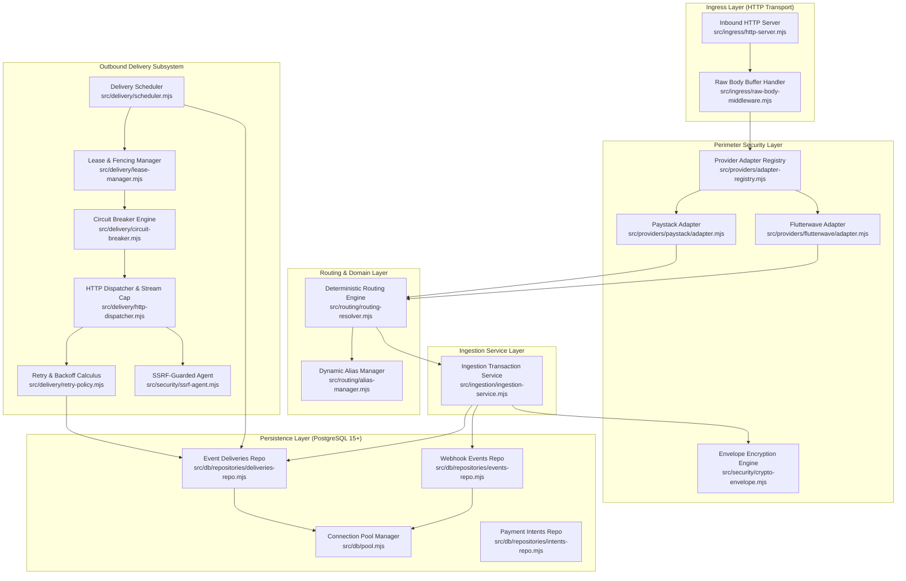
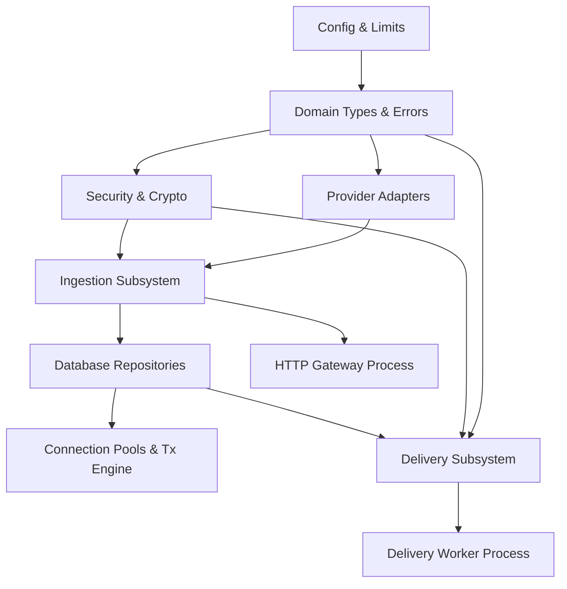

# Centralized Webhook Ingestion and Delivery Service (CWIDS)
## Comprehensive, Implementation-Ready Engineering Plan

**Document Identifier:** `CWIDS-PLAN-V1.0`  
**Classification:** Implementation Blueprint & Execution Plan  
**Target Repository Path:** `docs/CWIDS-IMPLEMENTATION-PLAN.md`  
**Associated Technical Specification:** `docs/CWIDS-TECHNICAL-SPECIFICATION.md`  
**Implementation Language:** Native ECMAScript Modules (`.mjs` only)  
**Static Verification Engine:** TypeScript `checkJs` via `jsconfig.json`  
**Runtime Target:** Node.js v24 LTS, Express 4.x, PostgreSQL 15+, PM2 Process Supervision  

---

## 1. Document Purpose and Status

This document defines the definitive, phased engineering execution plan for constructing the Centralized Webhook Ingestion and Delivery Service (CWIDS).

This is an execution-ready technical plan intended to guide an implementation engineer or autonomous coding agent through each construction phase without guessing architectural intent, fabricating abstractions, or making undocumented design trade-offs.

### Plan Status & Execution Boundaries
- **Current Status:** Approved for Phase 0 and Phase 1 execution.
- **Scope Discipline:** This document plans the concrete implementation of the approved technical specification (`docs/CWIDS-TECHNICAL-SPECIFICATION.md`). It does NOT implement application code, alter approved system invariants, or relax security requirements.
- **Execution Rule:** Every phase represents a verifiable, working increment of the system. An implementation agent MUST NOT proceed to phase $N+1$ until phase $N$ passes all automated unit, integration, type-checking, and architectural boundary checks.

---

## 2. Sources Inspected and Source Precedence

The implementation plan is derived directly from a complete review of the following source materials:

1. **`docs/CWIDS-TECHNICAL-SPECIFICATION.md` (Version 1.0-RC1, 207 KB, 3,079 lines):** The primary architectural, functional, security, and schema authority.
2. **`docs/cwids-architecture-update-v2.md`:** Authoritative record of post-hostile review amendments (`GAP-01` through `GAP-07`, `PARTIAL-01` through `PARTIAL-08`, `DEBT-01` through `DEBT-06`).
3. **`docs/cwids-architecture-update.md`:** First review revision context.
4. **`docs/architectute.md`:** Original baseline specification and domain model definitions.
5. **`README.md`:** Foundational system overview and operational philosophy.
6. **Repository Workspace Files:**
   - `package.json`: Current baseline manifest (`dependencies: dotenv, express, pg`; `"type": "commonjs"`).
   - `src/index.js`, `src/server.js`, `src/worker.js`, `src/config/index.js`, `src/db/pool.js`, `src/db/migrate.js`: Inspected and verified as initial placeholder stubs.
   - `src/db/migrations/001_initial_schema.sql`: 1-line comment stub.

### Source Precedence Hierarchy
Where conflicts or ambiguities arise during execution, the following precedence is binding:
1. Explicit project owner decisions.
2. `docs/CWIDS-TECHNICAL-SPECIFICATION.md` (Approved Engineering Contract).
3. `docs/cwids-architecture-update-v2.md` (Post-Review Amendments).
4. `docs/architectute.md` and repository `README.md`.
5. This implementation plan (`docs/CWIDS-IMPLEMENTATION-PLAN.md`).
6. Existing repository code stubs (considered preliminary scaffolding).

---

## 3. Current Repository Baseline

An inspection of the workspace (`c:\Users\John\Documents\CODE\back\webhook_gateway`) on 2026-10-28 reveals the following runtime baseline:

- **Node.js Environment:** `v24.19.0` (LTS)
- **NPM Environment:** `12.0.2`
- **Dependencies Manifest (`package.json`):**
  - Production Dependencies: `"dotenv": "^16.4.7"`, `"express": "^4.21.2"`, `"pg": "^8.13.1"`.
  - Development Dependencies: None present.
  - Module Setting: `"type": "commonjs"` (MUST be converted to support native `.mjs`).
  - Test Script: `"node --test"` (0 tests present).
- **Codebase Baseline:**
  - `src/index.js`: Minimal entry console log stub.
  - `src/server.js`: Empty CommonJS export stub (`module.exports = {}`).
  - `src/worker.js`: Empty CommonJS export stub (`module.exports = {}`).
  - `src/config/index.js`: Empty stub.
  - `src/db/pool.js` & `src/db/migrate.js`: Empty stubs.
  - `src/db/migrations/001_initial_schema.sql`: 1-line comment stub.
  - `tests/`: Contains only `.gitkeep`.
- **Tooling State:**
  - TypeScript compiler (`tsc`) is NOT installed locally.
  - No `jsconfig.json` exists.
  - No linting (`eslint`) or code formatting (`prettier`) configuration is present.

*Conclusion:* The repository is an unpopulated skeleton. Implementation must begin by establishing foundational tooling, ESM conventions, static checking, and database migrations before writing business logic.

---

## 4. Confirmed Requirements

The implementation plan is designed to satisfy 100% of the requirements catalogue established in Section 4 of `docs/CWIDS-TECHNICAL-SPECIFICATION.md`:

- **Functional Requirements:**
  - `FR-001`: Inbound raw-body cryptographic signature verification.
  - `FR-002`: Atomic persistence of events and initial delivery obligations (`Tx-Ingest`).
  - `FR-003`: Local deterministic routing (Modes A, B, C) with zero outbound network calls.
  - `FR-004`: Quarantine of unrouteable/ambiguous events (`awaiting_route`).
  - `FR-005`: Versioned inbound deduplication constraint (`uq_webhook_events_dedupe`).
  - `FR-006`: Decoupled asynchronous delivery execution via background workers.
  - `FR-007`: Leased work claiming via `FOR UPDATE SKIP LOCKED`.
  - `FR-008`: Monotonic fencing generation validation on worker completion updates.
  - `FR-009`: 72-hour payment-critical retry horizon with exponential backoff and full jitter.
  - `FR-010`: Outbound delivery HMAC-SHA256 signing.
  - `FR-011`: Payment-intent registration REST API (`POST /v1/internal/payment-intents`).
  - `FR-012`: Controlled manual delivery redrive preserving original event identity.
  - `FR-013`: Monotonic payment state transition enforcement in destination contracts.
- **Security Requirements:**
  - `SEC-001`: Exact raw byte capture prior to JSON parsing or string decoding.
  - `SEC-002`: Constant-time signature comparison via `crypto.timingSafeEqual`.
  - `SEC-003`: Connection-time SSRF defense with DNS resolution, IPv4/IPv6 private IP blocking, and socket pinning.
  - `SEC-004`: PostgreSQL Row-Level Security (RLS) forced across all tenant-scoped tables.
  - `SEC-005`: Application-layer envelope encryption using AES-256-GCM (DEK/KEK).
  - `SEC-006`: Tamper-evident administrative audit logging with transactional outbox export.
  - `SEC-007`: Outbound response body streaming truncation capped at exactly 2,048 bytes.
  - `SEC-008`: Least-privilege PostgreSQL roles (`cwids_ingress`, `cwids_worker`, `cwids_admin`, `cwids_migrator`).
- **Reliability & Performance Requirements:**
  - `REL-001`: Complete isolation between Ingress Gateway and Delivery Worker connection pools.
  - `REL-002`: Automated crash recovery for expired worker leases.
  - `REL-003`: Per-destination circuit breaker (5 failures / 60s $\to$ OPEN for 120s).
  - `PERF-001`: Ingress acknowledgement latency $<50$ms (p95) at 50 req/sec.
  - `PERF-002`: Worker claim query latency $<10$ms (p95) using partial indexes.

---

## 5. Assumptions and Unresolved Decisions

### Confirmed Operational Assumptions
1. **Node.js Native Capabilities:** Node.js v24 provides modern built-in APIs: native `node:test`, `node:crypto` (ciphers, HMAC, randomBytes, timingSafeEqual), `node:net`, `node:dns/promises`, and native ESM loading. No external libraries are needed for cryptography, testing, or networking.
2. **PostgreSQL Availability:** PostgreSQL 15+ is available with `pgcrypto` and `uuid-ossp` extensions enabled.
3. **Database Client:** The `pg` driver is used directly with explicit, parameterized SQL queries. An ORM is strictly prohibited.

### Unresolved Owner Decisions (Non-Blocking)
The following decisions from Section 55 of the technical specification require project owner approval before production deployment, but do NOT block phase-by-phase implementation:
1. **Hosting Profile:** Profile A (Single-host VPS, RPO 15m / RTO 2h) vs. Profile B (Multi-AZ Managed DB, RPO <1m / RTO 60s). *Implementation Assumption:* Code is written identically for both profiles.
2. **Reconciliation Provider Credentials:** Custody of provider REST API keys. *Implementation Assumption:* Core transport and local reconciliation are built first; provider REST verification is encapsulated in an isolated module.
3. **Data Retention Horizon:** Payload retention defaults to 30 days, metadata to 90 days, audits to 7 years. *Implementation Assumption:* Tunable via environment variables.

---

## 6. Architecture and Module Boundaries

CWIDS is implemented as a **modular monolith** with clean architectural boundaries. Modules communicate via typed in-memory interfaces or database transactions.



### Inviolable Dependency Rules
1. **Domain & Routing:** MUST NOT import Express, `pg`, or worker scheduling code.
2. **Provider Adapters:** MUST NOT access the database or make outbound network calls.
3. **HTTP Transport Handlers:** MUST NOT contain raw SQL or direct transaction management. All state mutations pass through service orchestrators.
4. **Repositories:** MUST contain pure parameterized SQL and return typed domain objects; MUST NOT contain HTTP or transport logic.
5. **Workers:** MUST NOT hold database transactions open across outbound HTTP calls.

---

## 7. Proposed Directory Tree

All application source files MUST use the `.mjs` extension. Existing CommonJS `.js` files will be safely migrated or superseded.

```text
webhook_gateway/
├── jsconfig.json                           # TypeScript checkJs configuration
├── package.json                            # Package manifest with ESM & scripts
├── ecosystem.config.cjs                    # PM2 process supervision configuration
├── docs/
│   ├── CWIDS-TECHNICAL-SPECIFICATION.md   # Authoritative Engineering Specification
│   └── CWIDS-IMPLEMENTATION-PLAN.md       # This Implementation Blueprint
├── src/
│   ├── index.mjs                           # Central bootstrap orchestrator
│   ├── server.mjs                          # Inbound HTTP Gateway entrypoint
│   ├── worker.mjs                          # Delivery Worker daemon entrypoint
│   ├── config/
│   │   ├── env.mjs                         # Validated environment configuration
│   │   └── limits.mjs                      # System bounds, timeouts, and byte limits
│   ├── types/
│   │   ├── domain.mjs                      # JSDoc type contracts for core entities
│   │   ├── provider.mjs                    # Provider adapter contracts
│   │   └── delivery.mjs                    # Delivery, claim, and attempt contracts
│   ├── errors/
│   │   ├── base-error.mjs                  # Abstract system error class
│   │   └── error-codes.mjs                 # Frozen error taxonomy enum
│   ├── db/
│   │   ├── pool.mjs                        # Isolated Ingress and Worker pools
│   │   ├── transaction.mjs                 # Transaction helper & RLS session wrapper
│   │   ├── migrate.mjs                     # Versioned migration runner
│   │   ├── migrations/
│   │   │   ├── 001_initial_schema.sql      # Core tables, checks, and foreign keys
│   │   │   ├── 002_row_level_security.sql  # RLS policies and application roles
│   │   │   └── 003_partial_indexes.sql     # Queue claim and lease performance indexes
│   │   └── repositories/
│   │       ├── applications-repo.mjs       # Tenant lookup & status queries
│   │       ├── connections-repo.mjs        # Provider connection config queries
│   │       ├── intents-repo.mjs            # Payment-intent correlation queries
│   │       ├── events-repo.mjs             # Webhook event persistence & dedupe
│   │       ├── deliveries-repo.mjs         # Leased claims & fenced completions
│   │       ├── attempts-repo.mjs           # Outbound attempt audit logger
│   │       └── audit-outbox-repo.mjs       # Transactional audit outbox repo
│   ├── providers/
│   │   ├── adapter-registry.mjs            # Adapter factory and registry
│   │   ├── base-adapter.mjs                # Base adapter contract definition
│   │   ├── flutterwave/
│   │   │   ├── adapter.mjs                 # Flutterwave HMAC/verif-hash adapter
│   │   │   └── fixtures.mjs                # Tested signed payload fixtures
│   │   └── paystack/
│   │       ├── adapter.mjs                 # Paystack HMAC-SHA512 adapter
│   │       └── fixtures.mjs                # Tested signed payload fixtures
│   ├── routing/
│   │   ├── routing-resolver.mjs            # Mode A, B, C deterministic router
│   │   └── alias-manager.mjs               # Dynamic correlation alias resolver
│   ├── ingestion/
│   │   ├── raw-body-middleware.mjs         # Strict byte-preserving middleware
│   │   ├── webhook-handler.mjs             # Express ingress route handler
│   │   └── ingestion-service.mjs           # Atomic Tx-Ingest orchestrator
│   ├── delivery/
│   │   ├── scheduler.mjs                   # Adaptive batch claiming engine
│   │   ├── lease-manager.mjs               # Monotonic fencing & lease expiration
│   │   ├── circuit-breaker.mjs             # Per-destination endpoint circuit breaker
│   │   ├── retry-policy.mjs                # 72-hour exponential backoff engine
│   │   └── http-dispatcher.mjs             # Outbound HTTP client with 2KB cap
│   ├── security/
│   │   ├── ssrf-agent.mjs                  # Connection-time DNS pinning https.Agent
│   │   ├── crypto-envelope.mjs             # AES-256-GCM envelope encryption
│   │   └── hmac-signer.mjs                 # Outbound HMAC-SHA256 delivery signer
│   ├── admin/
│   │   ├── internal-api.mjs                # Intent registration API (/v1/internal)
│   │   ├── admin-server.mjs                # Privileged management API (/v1/admin)
│   │   └── audit-service.mjs               # Administrative audit service
│   ├── maintenance/
│   │   ├── intent-cleanup.mjs              # Expired intent batch deletion worker
│   │   ├── audit-exporter.mjs              # Transactional outbox log sink exporter
│   │   └── reconciliation-worker.mjs       # Scheduled payment reconciliation engine
│   └── observability/
│       ├── logger.mjs                      # Structured JSON logger with redaction
│       └── metrics.mjs                     # Prometheus metrics registry (/metrics)
└── tests/
    ├── unit/                               # Sub-second pure unit tests
    │   ├── crypto-envelope.test.mjs
    │   ├── flutterwave-adapter.test.mjs
    │   ├── paystack-adapter.test.mjs
    │   ├── routing-resolver.test.mjs
    │   ├── retry-policy.test.mjs
    │   └── ssrf-agent.test.mjs
    ├── integration/                        # PostgreSQL integration tests (real DB)
    │   ├── migrations.test.mjs
    │   ├── ingestion-atomic.test.mjs
    │   ├── worker-fencing.test.mjs
    │   ├── tenant-rls.test.mjs
    │   └── intent-cleanup.test.mjs
    ├── fault-injection/                    # Concurrency, crashes, and network kills
    │   ├── concurrent-claims.test.mjs
    │   ├── stale-worker.test.mjs
    │   └── commit-disconnect.test.mjs
    └── fixtures/                           # Signed provider test vectors
        ├── flutterwave-valid.json
        └── paystack-valid.json
```

---

## 8. Module Responsibility Matrix

The following matrix documents the single primary responsibility, prohibited imports, and public contracts for every module:

| Module Path | Primary Responsibility | Explicitly Does NOT Own | Allowed Imports | Forbidden Imports | Phase Created |
| :--- | :--- | :--- | :--- | :--- | :--- |
| `src/config/env.mjs` | Parse and validate environment variables against schema | Process lifecycle; dynamic DB queries | `node:process`, `node:path` | Any `src/*` application module | Phase 2 |
| `src/db/pool.mjs` | Manage isolated Ingress and Worker `pg.Pool` instances | Query execution; transaction logic | `pg`, `src/config/env.mjs` | Repositories, Express, Workers | Phase 4 |
| `src/db/transaction.mjs`| Wrap SQL callbacks in `BEGIN...COMMIT` with RLS session | Business decisions; retry schedules | `src/db/pool.mjs`, `pg` | Express, Routing, Adapters | Phase 4 |
| `src/security/crypto-envelope.mjs`| AES-256-GCM encryption/decryption of raw payload bytes | Database persistence; JSON parsing | `node:crypto`, `src/config/env.mjs`| Repositories, Express | Phase 3 |
| `src/security/ssrf-agent.mjs` | Custom `https.Agent` with connection-time DNS pinning | HTTP routing; response interpretation | `node:https`, `node:net`, `node:dns/promises` | Repositories, Delivery scheduling | Phase 9 |
| `src/providers/flutterwave/adapter.mjs` | Flutterwave HMAC/verif-hash signature verification & parsing | Database queries; HTTP transport | `node:crypto`, `src/types/provider.mjs` | `src/db/*`, Express, Outbound HTTP | Phase 5 |
| `src/providers/paystack/adapter.mjs` | Paystack HMAC-SHA512 verification & normalization | Database queries; HTTP transport | `node:crypto`, `src/types/provider.mjs` | `src/db/*`, Express, Outbound HTTP | Phase 5 |
| `src/routing/routing-resolver.mjs` | Resolve event to application ID via Modes A, B, C | Outbound HTTP calls; JSON parsing | Repositories, `src/types/domain.mjs`| Express, External network clients | Phase 6 |
| `src/ingestion/ingestion-service.mjs` | Execute atomic `Tx-Ingest` (Event + Delivery persistence) | Outbound delivery; signature checks | Repositories, `src/db/transaction.mjs`| Delivery worker, HTTP Dispatcher | Phase 7 |
| `src/delivery/scheduler.mjs` | Batch work claiming via `FOR UPDATE SKIP LOCKED` | Outbound HTTP transmission | Repositories, `src/delivery/lease-manager.mjs` | Express, Ingress Gateway | Phase 8 |
| `src/delivery/lease-manager.mjs` | Manage fencing tokens and DB lease expiration | Network I/O; backoff calculation | `src/types/delivery.mjs` | Express, External network clients | Phase 8 |
| `src/delivery/http-dispatcher.mjs` | Dispatch outbound callbacks with 2KB streaming limit | Lease management; DB transactions | `node:https`, `src/security/ssrf-agent.mjs`| Database transactions | Phase 9 |
| `src/delivery/retry-policy.mjs` | Compute 72h exponential backoff with full jitter | Database updates; network calls | `src/types/delivery.mjs` | `pg`, Repositories | Phase 10 |
| `src/admin/internal-api.mjs` | REST endpoint for payment intent registration | Inbound webhook verification | Repositories, Express | Outbound HTTP delivery | Phase 11 |

---

## 9. Dependency-Direction Rules

To prevent architectural decay, CWIDS strictly enforces a directed acyclic graph (DAG) of dependencies:



### Dependency Invariants:
1. **No Layer Inversion:** A lower layer (e.g. `src/db/`) MUST NEVER import a higher layer (e.g. `src/ingestion/` or `src/delivery/`).
2. **Horizontal Decoupling:** Ingress HTTP handlers MUST NEVER import Delivery Worker code. The ONLY integration point between Ingress and Delivery is the PostgreSQL database table `event_deliveries`.
3. **Circular Import Prohibition:** Circular imports are treated as fatal build errors detected in CI via `madge`.

---

## 10. ESM and `.mjs` Policy

In accordance with Section 4 of the instructions:
1. **Extension Requirement:** All application source files and test suites MUST be named with the `.mjs` extension (e.g. `server.mjs`, `adapter.test.mjs`).
2. **Explicit Import Specifiers:** All relative module specifiers MUST include explicit file extensions:
   ```javascript
   // REQUIRED:
   import { IngestionService } from './ingestion-service.mjs';
   
   // FORBIDDEN (Will fail Node.js ESM resolution):
   import { IngestionService } from './ingestion-service';
   ```
3. **No CommonJS in Application Code:** The use of `require()`, `module.exports`, or `exports` in application source is prohibited. Third-party CJS packages (e.g. `pg`, `express`) are imported via standard ESM default/named syntax:
   ```javascript
   import pg from 'pg';
   const { Pool } = pg;
   ```
4. **Package Manifest Alignment:** `package.json` will be updated to specify `"type": "module"`, while entry points remain explicitly named `.mjs`.

---

## 11. JSDoc Conventions

To ensure type safety and self-documenting code without compiling TypeScript, the codebase adheres to strict JSDoc annotations:

### Mandatory Annotation Structure
Every exported function, class, and repository query MUST be annotated:

```javascript
/**
 * Executes the atomic ingestion transaction persisting an authenticated webhook event.
 *
 * Invariant: If routing resolves to an application, the event and its initial delivery
 * obligation MUST commit within the exact same database transaction before returning.
 *
 * @param {import('../types/domain.mjs').ValidatedWebhookInput} input - Verified provider payload.
 * @param {import('../types/domain.mjs').RoutingResolution} routing - Local routing outcome.
 * @returns {Promise<import('../types/domain.mjs').IngestionOutcome>} Outcome of the persistence.
 * @throws {DatabaseOperationError} If PostgreSQL transaction fails or times out.
 * @throws {StaleFencingTokenError} Never thrown in ingestion.
 */
export async function persistIngestedEvent(input, routing) {
  // Implementation...
}
```

### Prohibited JSDoc Anti-Patterns:
- `@type {any}` or `@param {any}` is strictly prohibited.
- Unbounded `Object` or `Function` types are prohibited; explicit object property definitions or typedef imports are required.
- Broad `// @ts-nocheck` or `// @ts-ignore` comments are banned.

---

## 12. `checkJs` Configuration and Enforcement

To resolve static checking requirements, CWIDS utilizes TypeScript's compiler in type-check-only mode via a root `jsconfig.json`.

### `jsconfig.json` Specification

```json
{
  "compilerOptions": {
    "target": "ES2022",
    "module": "NodeNext",
    "moduleResolution": "NodeNext",
    "allowJs": true,
    "checkJs": true,
    "noEmit": true,
    "strict": true,
    "alwaysStrict": true,
    "noImplicitAny": true,
    "noImplicitThis": true,
    "strictNullChecks": true,
    "strictFunctionTypes": true,
    "strictBindCallApply": true,
    "strictPropertyInitialization": true,
    "noImplicitReturns": true,
    "noFallthroughCasesInSwitch": true,
    "noUncheckedIndexedAccess": true,
    "allowSyntheticDefaultImports": true,
    "skipLibCheck": false
  },
  "include": [
    "src/**/*.mjs",
    "tests/**/*.mjs"
  ],
  "exclude": [
    "node_modules",
    "docs"
  ]
}
```

### Static Checking Script:
`package.json` will provide:
```json
"scripts": {
  "typecheck": "tsc --project jsconfig.json"
}
```
CI and phase gates MUST verify that `npm run typecheck` emits 0 errors before any code change is merged.

---

## 13. Linting, Formatting, Testing, and CI Policy

### 13.1 Tooling Architecture
- **Type Checking:** `typescript` (devDependency, executed via `tsc --project jsconfig.json`).
- **Test Runner:** Native Node.js Test Runner (`node --test`), requiring zero external test framework dependencies.
- **Circular Dependency Detector:** `madge` (devDependency, validating zero cycles).
- **Code Formatting & Linting:** `eslint` with `@eslint/js` configured for modern ESM.

### 13.2 Automated CI Verification Pipeline
Every pull request and phase completion must pass the automated gate script:
```bash
# Mandatory Verification Command Chain
npm run lint && npm run typecheck && npm run circular-check && npm test
```

---

## 14. Domain Contract Inventory

Before implementing application logic, cross-module contracts must be formally typed using JSDoc in `src/types/`.

### 14.1 Core Domain Entity Contracts (`src/types/domain.mjs`)

```javascript
/**
 * @typedef {object} ValidatedWebhookInput
 * @property {string} provider - Provider identifier ('flutterwave' | 'paystack').
 * @property {string} providerConnectionId - UUID of the provider connection.
 * @property {string} environment - Runtime environment ('live' | 'test').
 * @property {Buffer} rawBodyBuffer - Unaltered captured request body buffer.
 * @property {Record<string, string | string[] | undefined>} headers - Inbound HTTP headers.
 * @property {string} payloadSha256 - SHA-256 hex digest of rawBodyBuffer.
 * @property {any} parsedPayload - JSON parsed payload object.
 */

/**
 * @typedef {object} RoutingKeys
 * @property {string | null} merchantReference - Merchant order or transaction reference.
 * @property {string | null} providerReference - Provider transaction ID or flw_ref.
 * @property {string | null} virtualAccountId - Virtual bank account identifier.
 */

/**
 * @typedef {'resolved' | 'awaiting_route' | 'quarantined' | 'rejected'} RoutingStatus
 * @typedef {'MODE_A_MERCHANT_REFERENCE' | 'MODE_B_DEDICATED_CONNECTION' | 'MODE_C_DYNAMIC_ALIAS' | 'UNRESOLVED_NO_MATCH' | 'CONFLICT_MULTIPLE_MATCHES'} RoutingMode
 *
 * @typedef {object} RoutingResolution
 * @property {RoutingStatus} status - Routing disposition.
 * @property {string | null} applicationId - Target application UUID (if resolved).
 * @property {string | null} paymentIntentId - Associated intent UUID (if resolved).
 * @property {RoutingMode} routingMode - Mode used to determine ownership.
 */

/**
 * @typedef {object} IngestionOutcome
 * @property {string} eventId - CWIDS logical event UUID.
 * @property {boolean} isDuplicate - Whether this request matched an existing dedupe key.
 * @property {RoutingStatus} routingStatus - Final routing status.
 * @property {string | null} deliveryId - Delivery obligation UUID (if created).
 * @property {Date} committedAt - PostgreSQL commit timestamp.
 */
```

### 14.2 Delivery and Scheduling Contracts (`src/types/delivery.mjs`)

```javascript
/**
 * @typedef {'pending' | 'in_flight' | 'retry_scheduled' | 'delivered' | 'dead_lettered' | 'cancelled'} DeliveryStatus
 *
 * @typedef {object} DeliveryClaim
 * @property {string} deliveryId - Delivery UUID.
 * @property {string} eventId - Webhook event UUID.
 * @property {string} applicationId - Application UUID.
 * @property {string} destinationEndpointId - Active endpoint UUID.
 * @property {number} attemptCount - Prior attempt count.
 * @property {number} fencingToken - Monotonically incremented fencing generation token.
 * @property {Date | null} firstAttemptAt - Timestamp of first attempt.
 * @property {Date} leaseExpiresAt - Database lease expiration timestamp.
 */

/**
 * @typedef {'processed' | 'duplicate_acknowledged' | 'rejected' | 'http_acknowledged_unverified'} DestinationResponseStatus
 *
 * @typedef {object} DeliveryAttemptResult
 * @property {number} httpStatus - HTTP response status code (e.g. 200, 500).
 * @property {DestinationResponseStatus} responseStatus - Parsed destination status.
 * @property {string} responseExcerpt - Capped response excerpt (max 2,048 bytes).
 * @property {boolean} isTruncated - Whether response exceeded 2KB and was severed.
 * @property {number} durationMs - Socket elapsed duration in milliseconds.
 * @property {string | null} errorCode - System error code (e.g. 'ETIMEDOUT').
 * @property {string | null} errorMessage - Safe error description.
 */

/**
 * @typedef {object} RetryDecision
 * @property {boolean} shouldRetry - True if failure is classified as retryable.
 * @property {Date | null} nextAttemptAt - Scheduled timestamp for next attempt.
 * @property {boolean} isDeadLetter - True if 72-hour horizon or retries are exhausted.
 * @property {string | null} terminalReason - Reason code if transitioning to dead_lettered.
 */
```

---

## 15. Database and Migration Implementation Sequence

CWIDS manages database evolution through versioned, repeatable SQL migration files executed sequentially by `src/db/migrate.mjs`.

### 15.1 Migration File Inventory

#### 1. `src/db/migrations/001_initial_schema.sql` (Transactional)
- **Creates Extensions:** `uuid-ossp`, `pgcrypto`.
- **Creates Schema:** `cwids`.
- **Creates Tables:**
  - `applications`: Application tenant registry with `api_key_hash`.
  - `destination_endpoints`: Versioned callback URLs, secrets, and timeouts.
  - `provider_connections`: Provider accounts, environments, and KMS credentials.
  - `payment_intent_correlations`: Mode A routing intent records.
  - `payment_intent_aliases`: Mode C dynamic aliases (`virtual_account_id`, `provider_reference`).
  - `webhook_events`: Authoritative event store with AES-256-GCM ciphertext columns.
  - `event_deliveries`: Durable work queue with `fencing_token` and leases.
  - `delivery_attempts`: Append-only attempt history with 2KB response excerpt.
  - `circuit_breaker_states`: Per-destination circuit breaker state.
  - `administrative_audit_events`: Tamper-evident operational audit trail.
  - `audit_outbox`: Transactional outbox for remote audit export.
- **Enforces Constraints:**
  - `uq_webhook_events_dedupe` on `(provider_connection_id, environment, identity_strategy_version, dedupe_key)`.
  - `uq_intent_merchant_ref` on `(provider_connection_id, environment, merchant_reference)`.
  - `uq_intent_alias` on `(provider_connection_id, environment, alias_type, alias_value)`.
  - Check constraints for status enums, amounts $\ge 0$, and HTTPS-only callback URLs.

#### 2. `src/db/migrations/002_row_level_security.sql` (Transactional)
- Enables and forces Row-Level Security (`FORCE ROW LEVEL SECURITY`) across all tenant-scoped tables: `applications`, `destination_endpoints`, `payment_intent_correlations`, `webhook_events`, `event_deliveries`.
- Creates RLS policies enforcing `USING (application_id = NULLIF(current_setting('app.current_tenant', true), '')::uuid)`.
- Defines least-privilege database roles (`cwids_ingress`, `cwids_worker`, `cwids_admin`, `cwids_migrator`).

#### 3. `src/db/migrations/003_partial_indexes.sql` (Transactional / Concurrent)
- Creates partial indexes for ultra-fast queue claiming without scanning historical rows:
  - `idx_event_deliveries_claimable` ON `event_deliveries(next_attempt_at, id) WHERE status IN ('pending', 'retry_scheduled')`.
  - `idx_event_deliveries_leases` ON `event_deliveries(lease_expires_at) WHERE status = 'in_flight'`.
  - `idx_intent_cleanup` ON `payment_intent_correlations(expires_at, id) WHERE status IN ('active', 'expired')`.
- Configures aggressive autovacuum thresholds on `event_deliveries` (`scale_factor = 0.05`).

### 15.2 Migration Execution Protocol (`src/db/migrate.mjs`)
1. Connects to PostgreSQL using the `cwids_migrator` role.
2. Acquires an advisory lock (`SELECT pg_advisory_lock(991283749);`) to prevent concurrent migration races across instances.
3. Creates a `cwids.schema_migrations` table if it does not exist.
4. Reads all `.sql` files in `src/db/migrations/` ordered by filename prefix.
5. Executes unapplied migrations within individual `BEGIN...COMMIT` blocks.
6. Records applied migration version and timestamp.
7. Releases the advisory lock upon completion.

---

## 16. Transaction and Concurrency Catalogue

The following catalogue documents the 6 authoritative database transactions executed by CWIDS:

### Transaction 1: Ingestion Transaction (`Tx-Ingest`)
- **Execution Context:** Inbound HTTP Gateway process (`src/ingestion/ingestion-service.mjs`).
- **Isolation Level:** `READ COMMITTED`.
- **Tables Read:** `provider_connections`, `payment_intent_correlations`, `payment_intent_aliases`, `destination_endpoints`.
- **Tables Written:** `webhook_events`, `event_deliveries`, `audit_outbox`.
- **Concurrency & Races:** If two identical webhooks arrive concurrently, `uq_webhook_events_dedupe` raises a unique violation (`23505`) on the second insert. The transaction catches this, logs a duplicate observation, and commits cleanly without creating a second delivery.
- **Inviolable Rule:** Commits BEFORE HTTP 200 is dispatched to provider.

### Transaction 2: Batch Claim Transaction (`Tx-Claim`)
- **Execution Context:** Delivery Worker polling loop (`src/delivery/scheduler.mjs`).
- **Isolation Level:** `READ COMMITTED`.
- **Query Syntax:**
  ```sql
  WITH claimable AS (
    SELECT ed.id FROM event_deliveries ed
    JOIN circuit_breaker_states cb ON ed.destination_endpoint_id = cb.destination_endpoint_id
    WHERE ed.status IN ('pending', 'retry_scheduled')
      AND ed.next_attempt_at <= CURRENT_TIMESTAMP
      AND cb.state != 'open'
    ORDER BY ed.next_attempt_at ASC LIMIT $1
    FOR UPDATE OF ed SKIP LOCKED
  )
  UPDATE event_deliveries target
  SET status = 'in_flight',
      lease_expires_at = CURRENT_TIMESTAMP + $2::interval,
      fencing_token = target.fencing_token + 1,
      claimed_by_worker = $3
  FROM claimable WHERE target.id = claimable.id
  RETURNING target.id, target.fencing_token, target.lease_expires_at;
  ```
- **Inviolable Rule:** MUST commit and release connection BEFORE outbound HTTP dispatch begins.

### Transaction 3: Fenced Completion Transaction (`Tx-Complete`)
- **Execution Context:** Delivery Worker result handler (`src/delivery/lease-manager.mjs`).
- **Isolation Level:** `READ COMMITTED`.
- **Tables Written:** `event_deliveries`, `delivery_attempts`, `circuit_breaker_states`.
- **Fencing Clause:** `WHERE id = $1 AND fencing_token = $2`.
- **Concurrency & Races:** If a stalled worker attempts to complete after lease recovery, `fencing_token` will have been incremented by a subsequent claim. The query updates 0 rows; `StaleFencingTokenError` is thrown, rolling back the attempt record insert.

### Transaction 4: Expired Lease Recovery (`Tx-Recover`)
- **Execution Context:** Worker recovery sweep (`src/delivery/lease-manager.mjs`).
- **Isolation Level:** `READ COMMITTED`.
- **Query Syntax:** Updates rows in `in_flight` where `lease_expires_at < CURRENT_TIMESTAMP` to `status = 'retry_scheduled'`, clearing `claimed_by_worker`.

### Transaction 5: Payment Intent Registration (`Tx-Intent`)
- **Execution Context:** Internal API handler (`src/admin/internal-api.mjs`).
- **Isolation Level:** `READ COMMITTED`.
- **Tables Written:** `payment_intent_correlations`, `payment_intent_aliases`.
- **Constraints:** Enforces `uq_intent_merchant_ref` and `uq_intent_app_idempotency`.

### Transaction 6: Manual Redrive (`Tx-Redrive`)
- **Execution Context:** Admin API handler (`src/admin/admin-server.mjs`).
- **Isolation Level:** `READ COMMITTED`.
- **Tables Written:** `event_deliveries`, `administrative_audit_events`, `audit_outbox`.
- **Mutations:** Transitions `dead_lettered` delivery back to `pending`, increments `fencing_token`, preserves attempt history, and commits audit record atomically.

---

## 17. Security Implementation Matrix

The following matrix assigns every security control from the technical specification to its responsible module, test case, and verification criteria:

| Security Threat | Implemented Control | Target Module | Enforcement Phase | Mandatory Test Case | Acceptance Criteria |
| :--- | :--- | :--- | :--- | :--- | :--- |
| **Request Forgery** | Constant-time HMAC signature verification over raw byte buffers | `src/providers/*/adapter.mjs` | Phase 5 | `TC-01`, `TC-02` | Invalid signature rejected with HTTP 401; 0 bytes parsed. |
| **Timing Side-Channels** | Buffer length check before `crypto.timingSafeEqual` | `src/providers/base-adapter.mjs` | Phase 5 | `TC-02` | Mismatched length buffers fail closed without throwing unhandled exceptions. |
| **SSRF / DNS Rebinding** | Custom `https.Agent` resolving DNS and pinning socket to public IP | `src/security/ssrf-agent.mjs` | Phase 9 | `TC-23`, `TC-24`, `TC-25`| Calls to `127.0.0.1`, `169.254.169.254`, and private subnets abort at connection time. |
| **Cross-Tenant Data Leak**| PostgreSQL Row-Level Security (RLS) on all tenant tables | `src/db/migrations/002.sql` | Phase 4 | `TC-27` | Tenant A query without `WHERE` clause returns 0 rows belonging to Tenant B. |
| **Database Dump Exposure**| Application-layer Envelope Encryption using AES-256-GCM | `src/security/crypto-envelope.mjs` | Phase 3 | Inspect Ciphertext | Raw DB columns store ciphertext, nonce, tag, wrapped DEK; zero plaintext stored. |
| **Memory Exhaustion (DoS)**| 1MB inbound payload limit; 2,048-byte outbound response streaming cap | `src/ingress/raw-body-middleware.mjs`, `src/delivery/http-dispatcher.mjs` | Phase 5, Phase 9 | `TC-04`, `TC-37` | Inbound >1MB returns HTTP 413; Outbound >2KB destroys socket immediately. |
| **Audit Log Tampering** | Transactional outbox emitting structured JSON to remote sink | `src/maintenance/audit-exporter.mjs` | Phase 11 | Audit Outbox Test | Privileged redrives and routing changes committed to outbox table and exported. |
| **Least-Privilege Abuse** | Dedicated DB roles (`cwids_ingress`, `cwids_worker`, etc.) | `src/db/migrations/002.sql` | Phase 4 | SQL Permission Check | Runtime worker role cannot alter schema or read administrative secrets. |

---

## 18. Detailed Implementation Phases

The construction of CWIDS is structured into 15 dependency-ordered phases (Phase 0 through Phase 14). Every phase represents an independently verifiable milestone.

---

### Phase 0: Baseline Audit, Traceability & Tooling Verification
- **Objective:** Reconcile existing repository files, establish dependency constraints, and freeze baseline dependencies.
- **Why at this point:** Prevents retrofitting architecture to existing CommonJS stubs.
- **Prerequisites:** Workspace access to Node.js v24 LTS and npm.
- **Architectural Decisions Required:** ADR-01 (PostgreSQL as sole system of record), ESM `.mjs` enforcement.
- **Exact Files Affected:**
  - `package.json`: Convert `"type": "commonjs"` to `"type": "module"`; configure native test runner.
  - `docs/CWIDS-IMPLEMENTATION-PLAN.md`: Audited against specification.
- **Database Changes:** None.
- **Security Implications:** None.
- **Deferred Work:** Application code implementation.

#### Task Breakdown:
- **Task `P00-T01` — Repository Baseline Reconciliation & ESM Conversion**
  - **Objective:** Convert `package.json` to native ESM and add foundational scripts.
  - **Prerequisites:** None.
  - **Files Affected:** `package.json`.
  - **Exact Changes:** Set `"type": "module"`, `"main": "src/index.mjs"`. Add scripts: `"typecheck"`, `"test"`, `"lint"`.
  - **Commands:** `npm test`.
  - **Expected Result:** `node --test` executes with 0 failures.
  - **Acceptance Criteria:** `package.json` is valid JSON and Node.js executes tests cleanly.
  - **Definition of Done:** `npm test` exits code 0.
  - **Dependencies Unlocked:** Phase 1 tooling.

---

### Phase 1: Tooling Baseline, ESM Conventions & TypeScript `checkJs`
- **Objective:** Establish the static checking, linting, and circular-dependency detection toolchain.
- **Why at this point:** Guarantees that every subsequent file written is statically checked from line 1.
- **Prerequisites:** Phase 0 complete.
- **Architectural Decisions Required:** Strict TypeScript `checkJs` via `jsconfig.json`.
- **Exact Files Affected:**
  - `jsconfig.json` [NEW]: Strict compiler options, `checkJs: true`, `noEmit: true`.
  - `package.json` [MODIFY]: Add devDependencies (`typescript`, `@types/node`, `@types/express`, `@types/pg`, `madge`, `eslint`).
- **Database Changes:** None.
- **Security Implications:** Eliminates supply chain risks by pinning devDependencies.

#### Task Breakdown:
- **Task `P01-T01` — Install Type Definitions and TypeScript Compiler**
  - **Objective:** Add static checking dependencies to `devDependencies`.
  - **Prerequisites:** `P00-T01`.
  - **Files Affected:** `package.json`.
  - **Commands:** `npm install --save-dev typescript @types/node @types/express @types/pg madge`.
  - **Expected Result:** `package-lock.json` updated with pinned versions.
  - **Acceptance Criteria:** `npx tsc -v` outputs TypeScript compiler version.
- **Task `P01-T02` — Configure `jsconfig.json` & Typecheck Script**
  - **Objective:** Enforce strict typechecking across all `.mjs` source and test files.
  - **Prerequisites:** `P01-T01`.
  - **Files Affected:** `jsconfig.json`, `package.json`.
  - **Exact Changes:** Create `jsconfig.json` matching Section 12 specification. Add `"typecheck": "tsc --project jsconfig.json"`.
  - **Commands:** `npm run typecheck`.
  - **Expected Result:** Exits code 0 with zero diagnostics.
  - **Definition of Done:** `npm run typecheck` succeeds in CI.
  - **Dependencies Unlocked:** Phase 2 skeleton.

---

### Phase 2: Architecture Skeleton, Configuration & Composition Root
- **Objective:** Implement environment parsing, system limits, and process bootstrap lifecycles.
- **Why at this point:** Provides validated configuration and structured logging needed by persistence and networking.
- **Prerequisites:** Phase 1 complete.
- **Architectural Decisions Required:** Profile A single-host process topology with dedicated ingress/worker entry points.
- **Exact Files Affected:**
  - `src/config/env.mjs` [NEW]: Validates environment variables with hard failure on missing secrets.
  - `src/config/limits.mjs` [NEW]: System constants (1MB body, 2KB response, 72h horizon).
  - `src/observability/logger.mjs` [NEW]: Structured JSON logger with secret redaction filters.
  - `src/index.mjs` [NEW]: Unified process orchestrator.
  - `src/server.mjs` [NEW]: Ingress Gateway entrypoint.
  - `src/worker.mjs` [NEW]: Delivery Worker entrypoint.
  - `tests/unit/env-config.test.mjs` [NEW]: Unit tests for configuration validation.
- **Database Changes:** None.
- **Security Implications:** Prevents startup if `MASTER_KEK_SECRET` or `DATABASE_URL` is absent.

#### Task Breakdown:
- **Task `P02-T01` — Implement Validated Environment Configuration Loader**
  - **Objective:** Parse and typecheck environment variables at startup.
  - **Prerequisites:** Phase 1.
  - **Files Affected:** `src/config/env.mjs`, `src/config/limits.mjs`.
  - **Contracts:** Exports `env` object typed via JSDoc.
  - **Commands:** `npm run typecheck && node --test tests/unit/env-config.test.mjs`.
  - **Acceptance Criteria:** Throws descriptive error on invalid port or missing database URL.
- **Task `P02-T02` — Implement Structured Redacting Logger**
  - **Objective:** Provide structured JSON logging with automated credential redaction.
  - **Prerequisites:** `P02-T01`.
  - **Files Affected:** `src/observability/logger.mjs`.
  - **Security Invariant:** Redacts authorization tokens, passwords, and raw keys.
  - **Commands:** `node --test tests/unit/logger.test.mjs`.
  - **Dependencies Unlocked:** Phase 3 domain types.

---

### Phase 3: Core Domain Contracts, Runtime Validation & Typed Errors
- **Objective:** Establish frozen JSDoc domain type contracts, system error classes, and AES-256-GCM envelope encryption.
- **Why at this point:** Repositories, adapters, and services require typed domain structures and encryption primitives.
- **Prerequisites:** Phase 2 complete.
- **Architectural Decisions Required:** ADR-07 (AES-256-GCM Envelope Encryption with unique DEK).
- **Exact Files Affected:**
  - `src/types/domain.mjs` [NEW]: Domain entity typedefs (`ValidatedWebhookInput`, `RoutingResolution`).
  - `src/types/provider.mjs` [NEW]: Provider adapter interface typedefs.
  - `src/types/delivery.mjs` [NEW]: Delivery and attempt typedefs.
  - `src/errors/base-error.mjs` [NEW]: System error hierarchy.
  - `src/errors/error-codes.mjs` [NEW]: Frozen error code enum.
  - `src/security/crypto-envelope.mjs` [NEW]: AES-256-GCM encryption and DEK wrapping engine.
  - `tests/unit/crypto-envelope.test.mjs` [NEW]: Unit tests for encryption round-trips and tampered tags.
- **Database Changes:** None.
- **Security Implications:** Implements application-layer envelope encryption protecting raw payloads.

#### Task Breakdown:
- **Task `P03-T01` — Establish JSDoc Domain Type Definitions**
  - **Objective:** Create type contract files in `src/types/`.
  - **Files Affected:** `src/types/domain.mjs`, `src/types/provider.mjs`, `src/types/delivery.mjs`.
  - **Commands:** `npm run typecheck`.
  - **Acceptance Criteria:** Typechecker validates all typedefs without errors.
- **Task `P03-T02` — Implement Internal Error Hierarchy & Taxonomy**
  - **Objective:** Create typed system errors (`ValidationError`, `AuthenticationError`, `StaleFencingTokenError`).
  - **Files Affected:** `src/errors/base-error.mjs`, `src/errors/error-codes.mjs`.
  - **Commands:** `npm run typecheck`.
- **Task `P03-T03` — Implement AES-256-GCM Envelope Encryption Engine**
  - **Objective:** Encrypt raw payloads using per-event 256-bit DEKs and master KEK.
  - **Files Affected:** `src/security/crypto-envelope.mjs`, `tests/unit/crypto-envelope.test.mjs`.
  - **Security Invariant:** Tampered ciphertext or mismatched AAD MUST throw authentication error.
  - **Commands:** `node --test tests/unit/crypto-envelope.test.mjs`.
  - **Acceptance Criteria:** 100% test pass on encryption round-trip, tampered tag, and key unwrapping.
  - **Dependencies Unlocked:** Phase 4 database persistence.

---

### Phase 4: PostgreSQL Schema, Migrations, Connection Pools & RLS
- **Objective:** Construct the complete relational schema, partial indexes, Row-Level Security policies, and connection pools.
- **Why at this point:** Establishes the authoritative state machine and relational invariants before building ingestion.
- **Prerequisites:** Phase 3 complete; PostgreSQL 15+ instance available.
- **Architectural Decisions Required:** ADR-01 (PostgreSQL system of record), ADR-09 (PostgreSQL RLS for tenant isolation), DEBT-05 (Isolated pools).
- **Exact Files Affected:**
  - `src/db/migrations/001_initial_schema.sql` [NEW]: Full DDL (10 core tables, checks, foreign keys).
  - `src/db/migrations/002_row_level_security.sql` [NEW]: RLS policies and roles (`cwids_ingress`, `cwids_worker`).
  - `src/db/migrations/003_partial_indexes.sql` [NEW]: Partial indexes on claimable delivery states and autovacuum tuning.
  - `src/db/migrate.mjs` [NEW]: Advisory-locked transactional migration runner.
  - `src/db/pool.mjs` [NEW]: Separate Ingress Pool (`max: 20`) and Worker Pool (`max: 15`).
  - `src/db/transaction.mjs` [NEW]: Transaction wrapper with automatic `SET LOCAL app.current_tenant`.
  - `src/db/repositories/*` [NEW]: Repositories for applications, connections, intents, events, deliveries, attempts.
  - `tests/integration/migrations.test.mjs` [NEW]: Migration runner integration test.
  - `tests/integration/tenant-rls.test.mjs` [NEW]: Negative cross-tenant RLS query tests.
- **Database Changes:** 10 tables, 5 RLS policies, 3 partial indexes, 4 database roles created.
- **Security Implications:** Enforces database-level tenant isolation and least-privilege pool roles.

#### Task Breakdown:
- **Task `P04-T01` — Author Core PostgreSQL DDL Migrations**
  - **Objective:** Write migrations `001`, `002`, and `003` matching Section 15 of technical specification.
  - **Files Affected:** `src/db/migrations/001_initial_schema.sql`, `002_row_level_security.sql`, `003_partial_indexes.sql`.
  - **Verification:** Execute SQL syntax validation script against PostgreSQL 15+.
- **Task `P04-T02` — Implement Transactional Migration Runner**
  - **Objective:** Build `src/db/migrate.mjs` with advisory locking and version tracking.
  - **Commands:** `node src/db/migrate.mjs`.
  - **Expected Result:** Migrations 1, 2, 3 applied cleanly; recorded in `schema_migrations`.
- **Task `P04-T03` — Implement Isolated Connection Pools & Transaction Wrapper**
  - **Objective:** Provide separate Ingress and Worker pools with `set_config` RLS injection.
  - **Files Affected:** `src/db/pool.mjs`, `src/db/transaction.mjs`.
  - **Commands:** `node --test tests/integration/tenant-rls.test.mjs`.
  - **Acceptance Criteria:** Proves tenant A cannot read tenant B rows under RLS runtime role.
- **Task `P04-T04` — Implement Core Repositories**
  - **Objective:** Build repository modules in `src/db/repositories/`.
  - **Commands:** `npm run typecheck && node --test tests/integration/repositories.test.mjs`.
  - **Dependencies Unlocked:** Phase 5 provider adapters and Phase 7 ingestion.

---

### Phase 5: Provider Signature Verification & Raw-Body-Safe Ingress
- **Objective:** Construct the raw-byte preserving Express pipeline and cryptographic provider adapters.
- **Why at this point:** Ingress cannot accept webhooks without raw byte capture and signature verification.
- **Prerequisites:** Phase 3 domain types and Phase 4 repositories.
- **Architectural Decisions Required:** PARTIAL-04 (Express raw body order), SEC-001 (raw byte capture), SEC-002 (constant-time verification).
- **Exact Files Affected:**
  - `src/ingress/raw-body-middleware.mjs` [NEW]: `express.raw({ limit: '1mb' })` mounting exclusively on webhook routes.
  - `src/providers/base-adapter.mjs` [NEW]: Abstract adapter contract with constant-time equality checks.
  - `src/providers/flutterwave/adapter.mjs` [NEW]: Flutterwave HMAC-SHA256 & `verif-hash` verification.
  - `src/providers/paystack/adapter.mjs` [NEW]: Paystack HMAC-SHA512 verification.
  - `src/providers/adapter-registry.mjs` [NEW]: Adapter factory resolving providers by connection metadata.
  - `tests/unit/flutterwave-adapter.test.mjs` [NEW]: Signature verification tests with signed fixtures.
  - `tests/unit/paystack-adapter.test.mjs` [NEW]: Signature verification tests with signed fixtures.
- **Database Changes:** None.
- **Security Implications:** Blocks request forgery, timing attacks, and oversized payload attacks.

#### Task Breakdown:
- **Task `P05-T01` — Implement Raw Body Preserving Middleware**
  - **Objective:** Stream incoming requests into immutable `Buffer` objects, enforcing a 1MB ceiling.
  - **Files Affected:** `src/ingress/raw-body-middleware.mjs`.
  - **Security Invariant:** Rejects payloads $>1$MB with HTTP 413; preserves exact byte stream.
  - **Commands:** `node --test tests/unit/raw-body-middleware.test.mjs`.
- **Task `P05-T02` — Implement Flutterwave Provider Adapter**
  - **Objective:** Verify Flutterwave HMAC-SHA256 and `verif-hash` signatures against raw buffers.
  - **Files Affected:** `src/providers/flutterwave/adapter.mjs`, `tests/unit/flutterwave-adapter.test.mjs`.
  - **Commands:** `node --test tests/unit/flutterwave-adapter.test.mjs`.
  - **Acceptance Criteria:** Accepts valid signature; rejects invalid signature with HTTP 401; rejects buffer length mismatch safely.
- **Task `P05-T03` — Implement Paystack Provider Adapter**
  - **Objective:** Verify Paystack HMAC-SHA512 signatures against raw buffers.
  - **Files Affected:** `src/providers/paystack/adapter.mjs`, `tests/unit/paystack-adapter.test.mjs`.
  - **Commands:** `node --test tests/unit/paystack-adapter.test.mjs`.
  - **Dependencies Unlocked:** Phase 6 routing and normalization.

---

### Phase 6: Event Normalization, Identity & Deterministic Routing
- **Objective:** Normalize provider payloads, compute length-prefixed deduplication keys, and resolve application ownership locally.
- **Why at this point:** Ingestion requires routing resolution and identity computation prior to database persistence.
- **Prerequisites:** Phase 4 repositories and Phase 5 provider adapters.
- **Architectural Decisions Required:** ADR-02 (Local deterministic routing: Modes A, B, C), PARTIAL-01 (Length-prefixed dedupe keys).
- **Exact Files Affected:**
  - `src/routing/routing-resolver.mjs` [NEW]: Mode A (Intent), Mode B (Single-tenant), Mode C (Dynamic Alias), Mode D (Quarantine).
  - `src/routing/alias-manager.mjs` [NEW]: Lookup engine for `payment_intent_aliases`.
  - `tests/unit/routing-resolver.test.mjs` [NEW]: Unit tests for Modes A, B, C and collision quarantines.
  - `tests/unit/dedupe-canonicalization.test.mjs` [NEW]: Fuzz testing length-prefixed canonical key generation.
- **Database Changes:** None.
- **Security Implications:** Eliminates cross-tenant data leaks and delimiter collision attacks.

#### Task Breakdown:
- **Task `P06-T01` — Implement Versioned Deduplication Key Generator**
  - **Objective:** Generate canonical length-prefixed deduplication keys per provider.
  - **Files Affected:** `src/providers/flutterwave/adapter.mjs`, `src/providers/paystack/adapter.mjs`.
  - **Security Invariant:** Delimiter characters (`:`, `_`) in payload IDs cannot cause collision across distinct events.
  - **Commands:** `node --test tests/unit/dedupe-canonicalization.test.mjs`.
- **Task `P06-T02` — Implement Deterministic Routing Engine (Modes A, B, C, D)**
  - **Objective:** Map authenticated webhooks to application tenants without external network calls.
  - **Files Affected:** `src/routing/routing-resolver.mjs`, `src/routing/alias-manager.mjs`.
  - **Commands:** `node --test tests/unit/routing-resolver.test.mjs`.
  - **Acceptance Criteria:** Unmatched reference sets `routing_status = 'awaiting_route'`; multiple matches trigger quarantine.
  - **Dependencies Unlocked:** Phase 7 atomic ingestion.

---

### Phase 7: Transactional Ingestion & Durable Delivery Creation
- **Objective:** Implement the atomic `Tx-Ingest` service binding event persistence and delivery creation.
- **Why at this point:** Core ingress milestone; enables end-to-end receipt and persistence of provider webhooks.
- **Prerequisites:** Phase 4 repositories, Phase 5 adapters, Phase 6 routing engine.
- **Architectural Decisions Required:** P0-04 (Atomic persistence of event and initial delivery), INV-001 (No ack before commit).
- **Exact Files Affected:**
  - `src/ingestion/ingestion-service.mjs` [NEW]: Orchestrates 14-step atomic `Tx-Ingest`.
  - `src/ingestion/webhook-handler.mjs` [NEW]: Express controller translating HTTP requests to ingestion outcomes.
  - `src/ingress/http-server.mjs` [NEW]: Express app mounting routes and error boundaries.
  - `tests/integration/ingestion-atomic.test.mjs` [NEW]: Fault-injection tests verifying atomic persistence.
  - `tests/integration/duplicate-ingestion.test.mjs` [NEW]: Concurrent duplicate submission tests.
- **Database Changes:** Writes to `webhook_events`, `event_deliveries`, `audit_outbox`.
- **Security Implications:** Guarantees zero orphaned accepted events.

#### Task Breakdown:
- **Task `P07-T01` — Implement Ingestion Transaction Service (`Tx-Ingest`)**
  - **Objective:** Persist event, encrypt payload via AES-256-GCM, and insert delivery row within a single database transaction.
  - **Files Affected:** `src/ingestion/ingestion-service.mjs`.
  - **Invariants:** Resolved event MUST create delivery row in same transaction. Duplicate insert catches 23505 and acknowledges safely.
  - **Commands:** `node --test tests/integration/ingestion-atomic.test.mjs`.
- **Task `P07-T02` — Implement Inbound Webhook HTTP Controller**
  - **Objective:** Wire raw middleware, adapter verification, routing, and ingestion service to Express route.
  - **Files Affected:** `src/ingestion/webhook-handler.mjs`, `src/ingress/http-server.mjs`.
  - **Commands:** `node --test tests/integration/http-ingress.test.mjs`.
  - **Acceptance Criteria:** Valid webhook returns HTTP 200 within 50ms; invalid signature returns HTTP 401.
  - **Dependencies Unlocked:** Vertical Slice 1 (Ingestion Complete); Phase 8 delivery scheduler.

---

### Phase 8: Delivery State Machine, Atomic Claims, Leases & Fencing
- **Objective:** Implement background worker leased batch claiming via `FOR UPDATE SKIP LOCKED` and monotonic fencing.
- **Why at this point:** Deliveries committed in Phase 7 must be claimed and scheduled safely.
- **Prerequisites:** Phase 4 repositories and Phase 7 ingestion.
- **Architectural Decisions Required:** ADR-03 (`FOR UPDATE SKIP LOCKED`), ADR-04 (Monotonic fencing generations), DEBT-04 (Database-time leases).
- **Exact Files Affected:**
  - `src/delivery/scheduler.mjs` [NEW]: Polling engine with adaptive backoff (250ms to 5,000ms).
  - `src/delivery/lease-manager.mjs` [NEW]: Lease acquisition, fencing token validation, and lease recovery sweeps.
  - `tests/integration/worker-fencing.test.mjs` [NEW]: Stale worker rejection test.
  - `tests/integration/concurrent-claims.test.mjs` [NEW]: Multiple workers claiming from shared queue.
- **Database Changes:** Mutates `event_deliveries` (`status`, `fencing_token`, `lease_expires_at`).
- **Security Implications:** Prevents concurrent duplicate worker execution and stale database overwrites.

#### Task Breakdown:
- **Task `P08-T01` — Implement Leased Batch Claiming Engine**
  - **Objective:** Execute `FOR UPDATE SKIP LOCKED` batch claim setting `fencing_token = token + 1` and `lease_expires_at = now + 30s`.
  - **Files Affected:** `src/delivery/scheduler.mjs`.
  - **Invariants:** Workers MUST use database time (`CURRENT_TIMESTAMP`).
  - **Commands:** `node --test tests/integration/concurrent-claims.test.mjs`.
- **Task `P08-T02` — Implement Fenced Completion & Stale Worker Rejection**
  - **Objective:** Execute completion SQL with `WHERE id = $1 AND fencing_token = $2`.
  - **Files Affected:** `src/delivery/lease-manager.mjs`.
  - **Invariants:** If 0 rows updated, throw `StaleFencingTokenError` and roll back attempt insertion.
  - **Commands:** `node --test tests/integration/worker-fencing.test.mjs`.
- **Task `P08-T03` — Implement Expired Lease Crash Recovery Query**
  - **Objective:** Sweep and reclaim deliveries stranded by crashed worker processes.
  - **Files Affected:** `src/delivery/lease-manager.mjs`.
  - **Commands:** `node --test tests/integration/lease-recovery.test.mjs`.
  - **Dependencies Unlocked:** Phase 9 outbound HTTP execution.

---

### Phase 9: Outbound Delivery, Destination Validation, Signing & Timeouts
- **Objective:** Construct the SSRF-guarded HTTP client, outbound HMAC-SHA256 signer, and streaming response reader.
- **Why at this point:** Leased deliveries must be securely transmitted to destination endpoints.
- **Prerequisites:** Phase 8 delivery claiming.
- **Architectural Decisions Required:** ADR-06 (Connection-time DNS pinning SSRF agent), SEC-007 (2KB streaming cap), FR-010 (HMAC-SHA256 signing).
- **Exact Files Affected:**
  - `src/security/ssrf-agent.mjs` [NEW]: Custom `https.Agent` with DNS resolution, IPv4/IPv6 private IP filtering, and IP pinning.
  - `src/security/hmac-signer.mjs` [NEW]: Outbound delivery HMAC-SHA256 signature generator.
  - `src/delivery/http-dispatcher.mjs` [NEW]: Streaming HTTP client enforcing socket destruction at 2,048 bytes.
  - `tests/unit/ssrf-agent.test.mjs` [NEW]: Negative SSRF tests targeting loopback, private IPs, and metadata addresses.
  - `tests/unit/http-dispatcher.test.mjs` [NEW]: Response streaming truncation tests.
- **Database Changes:** Inserts into `delivery_attempts`.
- **Security Implications:** Blocks SSRF attacks, cloud credential theft, and destination memory exhaustion DoS.

#### Task Breakdown:
- **Task `P09-T01` — Implement SSRF-Guarded Connection-Time Agent**
  - **Objective:** Custom `https.Agent` resolving DNS and pinning TCP/TLS sockets to validated public IPs.
  - **Files Affected:** `src/security/ssrf-agent.mjs`, `tests/unit/ssrf-agent.test.mjs`.
  - **Security Invariant:** Aborts immediately on `127.0.0.1`, `10.0.0.0/8`, `169.254.169.254`, `::1`.
  - **Commands:** `node --test tests/unit/ssrf-agent.test.mjs`.
- **Task `P09-T02` — Implement Outbound Delivery HMAC Signer**
  - **Objective:** Compute `X-CWIDS-Signature` over canonical string `timestamp.deliveryId.rawPayload`.
  - **Files Affected:** `src/security/hmac-signer.mjs`.
  - **Commands:** `node --test tests/unit/hmac-signer.test.mjs`.
- **Task `P09-T03` — Implement Streaming HTTP Dispatcher with 2KB Cap**
  - **Objective:** Dispatch HTTPS POST with bounded timeouts; destroy socket if response $>2,048$ bytes.
  - **Files Affected:** `src/delivery/http-dispatcher.mjs`, `tests/unit/http-dispatcher.test.mjs`.
  - **Commands:** `node --test tests/unit/http-dispatcher.test.mjs`.
  - **Dependencies Unlocked:** Vertical Slice 2 (Full Delivery Pipeline Complete); Phase 10 retry engine.

---

### Phase 10: Retry Policy, Backpressure, Fairness & Circuit Breaker
- **Objective:** Implement the 72-hour exponential retry backoff engine, per-destination circuit breaker, and tenant concurrency limiter.
- **Why at this point:** Prevents failing destinations from monopolizing worker capacity or losing retry state across outages.
- **Prerequisites:** Phase 8 delivery scheduler and Phase 9 HTTP dispatcher.
- **Architectural Decisions Required:** ADR-08 (72h payment retry horizon), PARTIAL-05 (Per-destination circuit breaker).
- **Exact Files Affected:**
  - `src/delivery/retry-policy.mjs` [NEW]: Exponential backoff with full jitter, capping at 2h delay and 72h horizon.
  - `src/delivery/circuit-breaker.mjs` [NEW]: State machine tracking closed, open, and half-open canary states.
  - `tests/unit/retry-policy.test.mjs` [NEW]: Mathematical backoff calculation tests.
  - `tests/integration/circuit-breaker.test.mjs` [NEW]: Integration tests tripping breaker and executing half-open probe.
- **Database Changes:** Writes to `circuit_breaker_states` and updates `event_deliveries(next_attempt_at)`.
- **Security Implications:** Isolates failing tenants, eliminating noisy-neighbor worker starvation.

#### Task Breakdown:
- **Task `P10-T01` — Implement 72-Hour Exponential Backoff Calculus**
  - **Objective:** Calculate `next_attempt_at` using base 10s delay, 2h max delay, and full jitter; cap at 72h horizon.
  - **Files Affected:** `src/delivery/retry-policy.mjs`.
  - **Invariants:** Delays MUST NOT exceed 7,200s; deliveries exceeding 72h transition to `dead_lettered`.
  - **Commands:** `node --test tests/unit/retry-policy.test.mjs`.
- **Task `P10-T02` — Implement Per-Destination Circuit Breaker Engine**
  - **Objective:** Maintain circuit state per endpoint: 5 failures/60s $\to$ OPEN for 120s $\to$ HALF-OPEN single probe.
  - **Files Affected:** `src/delivery/circuit-breaker.mjs`.
  - **Commands:** `node --test tests/integration/circuit-breaker.test.mjs`.
- **Task `P10-T03` — Implement Tenant Concurrency Throttling**
  - **Objective:** Clamp active in-flight deliveries per tenant to `MAX_TENANT_CONCURRENCY = 10`.
  - **Files Affected:** `src/delivery/scheduler.mjs`.
  - **Dependencies Unlocked:** Phase 11 administrative APIs and management.

---

### Phase 11: Administrative APIs, Controlled Replay, Audit Outbox & Intent API
- **Objective:** Construct the internal payment-intent registration API, administrative management endpoints, and audit outbox exporter.
- **Why at this point:** Enables applications to register intents and allows operators to redrive failed deliveries safely.
- **Prerequisites:** Phase 4 repositories, Phase 7 ingestion, Phase 10 retry engine.
- **Architectural Decisions Required:** GAP-01 (Intent Registration API), GAP-06 (Audit outbox export), FR-012 (Controlled redrive).
- **Exact Files Affected:**
  - `src/admin/internal-api.mjs` [NEW]: Express router for `POST /v1/internal/payment-intents`.
  - `src/admin/admin-server.mjs` [NEW]: Privileged administrative API router (`/v1/admin/*`).
  - `src/admin/audit-service.mjs` [NEW]: Records privileged changes and queues outbox events.
  - `src/maintenance/audit-exporter.mjs` [NEW]: Worker draining `audit_outbox` to stdout/syslog.
  - `src/maintenance/intent-cleanup.mjs` [NEW]: Batch deletion worker for expired, unreferenced intents.
  - `tests/integration/intent-api.test.mjs` [NEW]: Intent registration, idempotency, and alias enrichment tests.
  - `tests/integration/admin-redrive.test.mjs` [NEW]: Controlled redrive test preserving event ID.
- **Database Changes:** Writes to `payment_intent_correlations`, `payment_intent_aliases`, `audit_outbox`.
- **Security Implications:** Enforces tenant-scoped Bearer token authentication on internal APIs.

#### Task Breakdown:
- **Task `P11-T01` — Implement Payment-Intent Registration REST API**
  - **Objective:** Expose `POST /v1/internal/payment-intents` with Bearer auth, idempotency keys, and minor units.
  - **Files Affected:** `src/admin/internal-api.mjs`.
  - **Commands:** `node --test tests/integration/intent-api.test.mjs`.
  - **Acceptance Criteria:** Valid intent returns 201; idempotent retry returns 200; duplicate key conflict returns 409.
- **Task `P11-T02` — Implement Controlled Administrative Redrive API**
  - **Objective:** Expose `POST /v1/admin/deliveries/:id/redrive` transitioning dead-lettered job to pending with audit trail.
  - **Files Affected:** `src/admin/admin-server.mjs`.
  - **Invariants:** Preserves original `event_id` and delivery history; increments `fencing_token`.
  - **Commands:** `node --test tests/integration/admin-redrive.test.mjs`.
- **Task `P11-T03` — Implement Transactional Audit Outbox Exporter**
  - **Objective:** Background daemon reading `audit_outbox` and emitting structured JSON records to remote log collector.
  - **Files Affected:** `src/maintenance/audit-exporter.mjs`.
- **Task `P11-T04` — Implement Expired Intent Batch Cleanup Worker**
  - **Objective:** Delete expired intents older than 7 days in batches of 1,000 without deleting linked event records.
  - **Files Affected:** `src/maintenance/intent-cleanup.mjs`.
  - **Commands:** `node --test tests/integration/intent-cleanup.test.mjs`.
  - **Dependencies Unlocked:** Phase 12 observability and operational tooling.

---

### Phase 12: Observability, Operational Runbooks & Graceful Shutdown
- **Objective:** Instrument the service with Prometheus telemetry, health/liveness probes, and graceful process termination.
- **Why at this point:** Operational visibility is required before subjecting the system to chaos and concurrency testing.
- **Prerequisites:** Phases 7 through 11 complete.
- **Architectural Decisions Required:** Profile A/B process supervision and shutdown deadlines.
- **Exact Files Affected:**
  - `src/observability/metrics.mjs` [NEW]: Prometheus client exposing `/metrics` on internal port 9090.
  - `src/ingress/health.mjs` [NEW]: Liveness (`/live`) and database-backed Readiness (`/ready`) probes.
  - `src/server.mjs` [MODIFY]: Wire `SIGTERM`/`SIGINT` graceful drain handlers (10s deadline).
  - `src/worker.mjs` [MODIFY]: Wire `SIGTERM`/`SIGINT` graceful drain handlers (30s deadline).
  - `tests/integration/health-probes.test.mjs` [NEW]: Health check integration tests.
- **Database Changes:** None.
- **Security Implications:** Health probes isolate internal DB metrics from public perimeter.

#### Task Breakdown:
- **Task `P12-T01` — Implement Prometheus Telemetry Registry**
  - **Objective:** Instrument counters and gauges for ingress requests, signature failures, queue depth, and lease expirations.
  - **Files Affected:** `src/observability/metrics.mjs`.
  - **Commands:** `curl http://localhost:9090/metrics`.
- **Task `P12-T02` — Implement Liveness and Readiness Probes**
  - **Objective:** `/live` verifies event loop; `/ready` verifies PostgreSQL connection pool health.
  - **Files Affected:** `src/ingress/health.mjs`.
  - **Commands:** `node --test tests/integration/health-probes.test.mjs`.
- **Task `P12-T03` — Implement Graceful Process Termination Handlers**
  - **Objective:** Close listening sockets; allow in-flight commits to drain; terminate pools cleanly.
  - **Files Affected:** `src/server.mjs`, `src/worker.mjs`.
  - **Dependencies Unlocked:** Phase 13 chaos and concurrency hardening.

---

### Phase 13: Security, Failure-Injection & Concurrency Hardening
- **Objective:** Execute the complete 38-scenario failure catalog, concurrency race conditions, and property-based tests.
- **Why at this point:** Validates all system invariants under adversarial conditions before production readiness.
- **Prerequisites:** All core components implemented (Phases 1-12).
- **Architectural Decisions Required:** Validation of all 10 formal invariants (`INV-001` through `INV-010`).
- **Exact Files Affected:**
  - `tests/fault-injection/concurrent-claims.test.mjs` [NEW]: 10 workers claiming 100 jobs simultaneously.
  - `tests/fault-injection/stale-worker.test.mjs` [NEW]: Worker paused 40s attempts update after lease recovery.
  - `tests/fault-injection/commit-disconnect.test.mjs` [NEW]: Kill TCP connection during commit.
  - `tests/fault-injection/ssrf-rebind.test.mjs` [NEW]: Dynamic DNS rebinding test suite.
  - `tests/unit/property-invariants.test.mjs` [NEW]: Fast-check generative tests on backoff and deduplication.
- **Database Changes:** None.
- **Security Implications:** Proves system resilience against race conditions, network cuts, and SSRF attacks.

#### Task Breakdown:
- **Task `P13-T01` — Execute 38 Mandatory Failure Scenarios**
  - **Objective:** Run complete automated test matrix (`TC-01` through `TC-38`) from technical specification.
  - **Commands:** `node --test tests/fault-injection/*.test.mjs`.
  - **Acceptance Criteria:** 100% of 38 tests pass with zero invariant violations.
- **Task `P13-T02` — Execute Property-Based Invariant Verification**
  - **Objective:** Verify backoff calculations never exceed 72h horizon across 10,000 generated inputs.
  - **Files Affected:** `tests/unit/property-invariants.test.mjs`.
  - **Commands:** `node --test tests/unit/property-invariants.test.mjs`.
  - **Dependencies Unlocked:** Phase 14 deployment readiness and go-live.

---

### Phase 14: Deployment Readiness, Backup/Restore Verification & Go-Live
- **Objective:** Configure production process supervision (PM2), execute disaster recovery restore drills, and sign off the Go/No-Go checklist.
- **Why at this point:** Final operational gate prior to accepting live financial payment traffic.
- **Prerequisites:** 100% test pass across Phases 1-13.
- **Architectural Decisions Required:** Final approval of Production Go/No-Go Checklist (Section 56 of specification).
- **Exact Files Affected:**
  - `ecosystem.config.cjs` [NEW]: Production PM2 clustering and fork configuration.
  - `scripts/restore-drill.sh` [NEW]: Automated DR restoration drill script.
- **Database Changes:** None.
- **Security Implications:** Verifies off-site backup recovery and encryption integrity.

#### Task Breakdown:
- **Task `P14-T01` — Configure PM2 Process Supervision**
  - **Objective:** Create `ecosystem.config.cjs` specifying 2 Gateway cluster instances and 1 Worker fork instance.
  - **Files Affected:** `ecosystem.config.cjs`.
  - **Commands:** `pm2 start ecosystem.config.cjs --env production`.
- **Task `P14-T02` — Execute Automated Disaster Recovery Restore Drill**
  - **Objective:** Restore physical base backup and apply WAL archives to clean instance; verify data integrity.
  - **Commands:** `bash scripts/restore-drill.sh`.
  - **Acceptance Criteria:** RPO $<15$ minutes and RTO $<2$ hours verified against test database.
- **Task `P14-T03` — Final Production Go/No-Go Sign-Off**
  - **Objective:** Validate all 12 items on Production Checklist (Section 56).
  - **Exit Gate:** Production webhook endpoints enabled for Flutterwave and Paystack.

---

## 19. File-Level Work Breakdown

The following comprehensive table catalogues every file created, modified, or migrated across the entire implementation lifecycle:

| File Path | Action | Primary Responsibility | Direct Dependencies | Target Test Suite | Acceptance Criteria |
| :--- | :--- | :--- | :--- | :--- | :--- |
| `package.json` | Modify | Declare dependencies, `"type": "module"`, and npm verification scripts | None | `npm test` | Valid JSON; scripts `typecheck`, `test`, `lint` run cleanly. |
| `jsconfig.json` | Create | Configure strict TypeScript `checkJs` for ESM without emit | `typescript` | `npm run typecheck` | `tsc --project jsconfig.json` passes with 0 errors. |
| `ecosystem.config.cjs` | Create | Production PM2 process configuration for Gateway cluster and Worker fork | PM2 | PM2 startup test | Gateway spawns 2 instances; Worker spawns 1 instance. |
| `src/index.mjs` | Create | Central process orchestrator booting standalone or clustered instances | `src/config/env.mjs` | `node src/index.mjs` | Boots Gateway or Worker based on CLI flags. |
| `src/server.mjs` | Create | Inbound HTTP Gateway process bootstrap and listener | `src/ingress/http-server.mjs` | `node src/server.mjs` | Binds to PORT 3000; passes readiness checks. |
| `src/worker.mjs` | Create | Background delivery worker daemon loop | `src/delivery/scheduler.mjs` | `node src/worker.mjs` | Executes adaptive polling loop; reclaims expired leases. |
| `src/config/env.mjs` | Create | Parse and validate environment variables at startup | `node:process` | `env-config.test.mjs` | Throws descriptive error on invalid port or missing secret. |
| `src/config/limits.mjs` | Create | System quotas, timeout boundaries, and byte caps | None | `npm run typecheck` | Exports frozen limits object (1MB body, 2KB response, 72h). |
| `src/types/domain.mjs` | Create | JSDoc typedefs for core domain entities and routing results | None | `npm run typecheck` | Statically validated by TypeScript checker. |
| `src/types/provider.mjs`| Create | JSDoc typedefs for provider adapters and verification contracts | None | `npm run typecheck` | Statically validated by TypeScript checker. |
| `src/types/delivery.mjs`| Create | JSDoc typedefs for delivery claims, attempts, and retries | None | `npm run typecheck` | Statically validated by TypeScript checker. |
| `src/errors/base-error.mjs`| Create | Abstract system error class with stable error codes | None | `npm run typecheck` | Preserves stack trace and stable machine-readable code. |
| `src/errors/error-codes.mjs`| Create | Frozen enum of all system error codes | None | `npm run typecheck` | No duplicate error strings. |
| `src/db/pool.mjs` | Create | Isolated Ingress (`max: 20`) and Worker (`max: 15`) connection pools | `pg`, `src/config/env.mjs` | `tenant-rls.test.mjs` | Pools acquire clients with bounded connection timeouts. |
| `src/db/transaction.mjs`| Create | Transaction helper setting `app.current_tenant` inside transactions | `src/db/pool.mjs` | `tenant-rls.test.mjs` | Rolls back on error; guarantees tenant session isolation. |
| `src/db/migrate.mjs` | Create | Transactional migration runner with PostgreSQL advisory locking | `pg` | `migrations.test.mjs` | Applies unapplied migrations in order; records version. |
| `src/db/migrations/001_initial_schema.sql` | Create | Core DDL for 10 tables, unique constraints, and foreign keys | PostgreSQL 15+ | `migrations.test.mjs` | Executes cleanly on clean database. |
| `src/db/migrations/002_row_level_security.sql`| Create | RLS policies and database roles (`cwids_ingress`, etc.) | Migration 001 | `tenant-rls.test.mjs` | Enforces tenant boundary at SQL engine tier. |
| `src/db/migrations/003_partial_indexes.sql` | Create | Partial indexes on claimable delivery states & autovacuum tuning | Migration 001 | `concurrent-claims.test.mjs` | Index scans utilized on `status IN ('pending', 'retry_scheduled')`. |
| `src/db/repositories/applications-repo.mjs` | Create | Repository for application tenant records | `src/db/transaction.mjs` | `repositories.test.mjs`| Queries applications by ID or API key hash. |
| `src/db/repositories/connections-repo.mjs` | Create | Repository for provider connection records | `src/db/transaction.mjs` | `repositories.test.mjs`| Retrieves connection metadata and KMS references. |
| `src/db/repositories/intents-repo.mjs` | Create | Repository for payment intent correlations and dynamic aliases | `src/db/transaction.mjs` | `intent-api.test.mjs` | Enforces `uq_intent_merchant_ref` and `uq_intent_alias`. |
| `src/db/repositories/events-repo.mjs` | Create | Repository for webhook events and deduplication checks | `src/db/transaction.mjs` | `ingestion-atomic.test.mjs` | Handles duplicate key conflicts (23505) cleanly. |
| `src/db/repositories/deliveries-repo.mjs` | Create | Repository for delivery claims, updates, and lease sweeps | `src/db/transaction.mjs` | `worker-fencing.test.mjs` | Implements `FOR UPDATE SKIP LOCKED` and fenced updates. |
| `src/db/repositories/attempts-repo.mjs` | Create | Append-only repository for outbound network attempts | `src/db/transaction.mjs` | `worker-fencing.test.mjs` | Inserts attempt records with 2KB capped response. |
| `src/db/repositories/audit-outbox-repo.mjs`| Create | Repository for administrative audit outbox queue | `src/db/transaction.mjs` | `admin-redrive.test.mjs`| Inserts outbox rows committed with administrative actions. |
| `src/providers/base-adapter.mjs` | Create | Abstract adapter base with constant-time equality helper | `node:crypto` | `flutterwave-adapter.test.mjs`| Buffer length mismatch fails closed safely. |
| `src/providers/flutterwave/adapter.mjs` | Create | Flutterwave HMAC-SHA256 and `verif-hash` signature verification | `node:crypto` | `flutterwave-adapter.test.mjs`| Verifies raw bytes; normalizes transaction payload. |
| `src/providers/paystack/adapter.mjs` | Create | Paystack HMAC-SHA512 signature verification and parsing | `node:crypto` | `paystack-adapter.test.mjs` | Verifies raw bytes; normalizes charge/transfer payload. |
| `src/providers/adapter-registry.mjs` | Create | Factory resolving provider adapter by provider name string | Adapters | `npm run typecheck` | Throws descriptive error on unsupported provider. |
| `src/routing/routing-resolver.mjs` | Create | Deterministic local routing engine (Modes A, B, C, D) | Repositories | `routing-resolver.test.mjs` | Zero external network calls; quarantines unmatched events. |
| `src/routing/alias-manager.mjs` | Create | Helper querying `payment_intent_aliases` for dynamic IDs | Repositories | `routing-resolver.test.mjs` | Resolves virtual account and provider reference aliases. |
| `src/ingress/raw-body-middleware.mjs` | Create | Express middleware capturing raw `Buffer` with 1MB ceiling | `express` | `raw-body-middleware.test.mjs`| Rejects $>1$MB with HTTP 413; preserves unparsed bytes. |
| `src/ingress/webhook-handler.mjs` | Create | Express controller for `/v1/webhooks/:provider/:connectionId` | Services | `http-ingress.test.mjs` | Returns HTTP 200 within 50ms upon commit. |
| `src/ingress/http-server.mjs` | Create | Express application setup, routes, and error boundaries | Express | `http-ingress.test.mjs` | Mounts raw body middleware exclusively on webhook routes. |
| `src/ingestion/ingestion-service.mjs` | Create | Ingestion service orchestrating 14-step atomic `Tx-Ingest` | Repositories | `ingestion-atomic.test.mjs` | Event and delivery rows committed in single transaction. |
| `src/delivery/scheduler.mjs` | Create | Work claiming engine with adaptive polling (250ms - 5s) | Repositories | `concurrent-claims.test.mjs`| Drains queue concurrently up to `WORKER_CONCURRENCY`. |
| `src/delivery/lease-manager.mjs` | Create | Monotonic fencing token validation and lease recovery sweeps | Repositories | `worker-fencing.test.mjs` | Stale write updates 0 rows; throws error. |
| `src/delivery/circuit-breaker.mjs` | Create | Per-destination circuit breaker tracking closed/open/half-open | Repositories | `circuit-breaker.test.mjs` | Halts requests to failing endpoints after 5 failures in 60s. |
| `src/delivery/retry-policy.mjs` | Create | 72-hour exponential backoff with full jitter formula | `src/config/limits.mjs` | `retry-policy.test.mjs` | Capped at 2h delay and 72h overall horizon. |
| `src/delivery/http-dispatcher.mjs` | Create | Streaming HTTP client with 2,048-byte truncation limit | `node:https` | `http-dispatcher.test.mjs` | Socket destroyed immediately when response $>2$KB. |
| `src/security/ssrf-agent.mjs` | Create | Custom `https.Agent` with DNS resolution and IP pinning | `node:https`, `node:dns` | `ssrf-agent.test.mjs` | Aborts connections targeting loopback, private, or metadata IPs. |
| `src/security/crypto-envelope.mjs` | Create | AES-256-GCM envelope encryption engine (DEK/KEK) | `node:crypto` | `crypto-envelope.test.mjs` | Authenticated Additional Data (AAD) bound to event ID. |
| `src/security/hmac-signer.mjs` | Create | Outbound delivery HMAC-SHA256 signature generator | `node:crypto` | `hmac-signer.test.mjs` | Generates canonical signature string over timestamp and body. |
| `src/admin/internal-api.mjs` | Create | REST API router for `POST /v1/internal/payment-intents` | Repositories | `intent-api.test.mjs` | Validates integer minor units; enforces idempotency. |
| `src/admin/admin-server.mjs` | Create | Privileged administrative management REST API | Repositories | `admin-redrive.test.mjs` | Requires admin token; audits manual redrives. |
| `src/admin/audit-service.mjs` | Create | Service logging operational actions and writing to outbox | Repositories | `admin-redrive.test.mjs` | Commits audit event and outbox row atomically. |
| `src/maintenance/intent-cleanup.mjs` | Create | Scheduled worker deleting expired, unreferenced intents | Repositories | `intent-cleanup.test.mjs` | Deletes in 1,000-row chunks; preserves referenced intents. |
| `src/maintenance/audit-exporter.mjs` | Create | Daemon draining `audit_outbox` to stdout/syslog | Repositories | `audit-exporter.test.mjs` | Emits structured JSON records for SIEM ingestion. |
| `src/observability/logger.mjs` | Create | Structured JSON logger with automated credential redaction | `node:process` | `logger.test.mjs` | Emits machine-readable logs; redacts secrets. |
| `src/observability/metrics.mjs` | Create | Prometheus metrics registry exposing `/metrics` on port 9090 | None | `metrics.test.mjs` | Instruments counters, histograms, and gauges. |
| `src/ingress/health.mjs` | Create | Liveness (`/live`) and database-backed Readiness (`/ready`) | `src/db/pool.mjs` | `health-probes.test.mjs` | Returns HTTP 503 when database pool is unreachable. |

---

## 20. Vertical-Slice Strategy

To avoid prolonged horizontal development without end-to-end functionality, the implementation is organized into four cumulative vertical slices:

```mermaid
journey
    title CWIDS Vertical Slice Progression
    section Slice 1: Atomic Ingestion
      Raw byte capture: 5: Gateway
      HMAC verification: 5: Flutterwave
      Local Mode B routing: 4: Router
      Atomic Tx-Ingest: 5: PostgreSQL
      HTTP 200 Ack: 5: Gateway
    section Slice 2: Outbound Leased Delivery
      Batch claim (SKIP LOCKED): 5: Worker
      SSRF-Guarded HTTPS: 5: Agent
      HMAC Outbound Sign: 5: Worker
      Destination Inbox Ack: 5: Mock Receiver
      Fenced Completion: 5: PostgreSQL
    section Slice 3: Retries & Resilience
      500 Error Classification: 4: Worker
      72h Backoff Calculation: 5: Policy
      Circuit Breaker Trip: 4: Breaker
      Matured Retry Dispatch: 5: Worker
    section Slice 4: Multi-Tenant & Operations
      Payment-Intent API: 5: Internal API
      Mode A & C Dynamic Routing: 5: Router
      PostgreSQL RLS Isolation: 5: DB
      Manual Admin Redrive: 4: Admin API
```

### Vertical Slice 1: End-to-End Atomic Ingestion (Completed in Phase 7)
- **Scope:** Inbound HTTP Gateway $\to$ Express Raw Middleware $\to$ Flutterwave Adapter $\to$ Dedicated Provider Connection (Mode B) $\to$ Atomic `Tx-Ingest` $\to$ PostgreSQL commit $\to$ Provider HTTP 200.
- **Verification:** Submit real signed Flutterwave webhook; verify HTTP 200 returned within 50ms and rows committed in `webhook_events` and `event_deliveries`.

### Vertical Slice 2: Outbound Leased Delivery & Fencing (Completed in Phase 9)
- **Scope:** Delivery Worker $\to$ `FOR UPDATE SKIP LOCKED` claim $\to$ SSRF-Guarded HTTPS Agent $\to$ Outbound HMAC-SHA256 signature $\to$ Destination mock receiver $\to$ Fenced database completion.
- **Verification:** Worker claims delivery, dispatches HTTPS to mock application, validates `fencing_token`, and marks status `delivered`.

### Vertical Slice 3: 72-Hour Retries & Circuit Breaking (Completed in Phase 10)
- **Scope:** Destination failure (500 / Timeout) $\to$ Retry policy calculation (exponential backoff + jitter) $\to$ Circuit breaker trip to OPEN $\to$ Cooldown $\to$ Half-open canary probe $\to$ Matured retry execution.
- **Verification:** Mock destination fails 5 times; circuit breaker halts traffic; probe succeeds after cooldown; backlog drains cleanly.

### Vertical Slice 4: Full Multi-Tenant Control Plane & Hardening (Completed in Phase 14)
- **Scope:** Application registers intent via `POST /v1/internal/payment-intents` $\to$ Inbound webhook matches Mode A $\to$ Delivery dispatches $\to$ Audit outbox exported $\to$ Manual redrive executed via Admin API.
- **Verification:** Complete 38-scenario failure and concurrency matrix passes in CI.

---

## 21. Testing and Failure-Injection Matrix

Every mandatory failure scenario from Section 46 of the technical specification is mapped to its automated test file and verification command:

| Test ID | Test Scenario | Target Test File | Automated Verification Command | Pass/Fail Acceptance Criteria |
| :--- | :--- | :--- | :--- | :--- |
| `TC-01` | Authentic Ingestion | `tests/integration/ingestion-atomic.test.mjs` | `node --test tests/integration/ingestion-atomic.test.mjs` | Event committed (`resolved`); Delivery created (`pending`). |
| `TC-02` | Invalid Signature | `tests/unit/flutterwave-adapter.test.mjs` | `node --test tests/unit/flutterwave-adapter.test.mjs` | Rejects with HTTP 401; zero database mutations. |
| `TC-04` | Body > 1MB Ceiling | `tests/unit/raw-body-middleware.test.mjs` | `node --test tests/unit/raw-body-middleware.test.mjs` | Socket destroyed immediately; returns HTTP 413. |
| `TC-05` | Normal Duplicate | `tests/integration/duplicate-ingestion.test.mjs`| `node --test tests/integration/duplicate-ingestion.test.mjs`| Returns HTTP 200; zero duplicate deliveries created. |
| `TC-07` | Unmatched Intent | `tests/integration/routing-quarantine.test.mjs` | `node --test tests/integration/routing-quarantine.test.mjs` | Persisted as `awaiting_route`; alert emitted. |
| `TC-13` | Concurrent Ingest Race | `tests/fault-injection/concurrent-claims.test.mjs`| `node --test tests/fault-injection/concurrent-claims.test.mjs`| 2 concurrent inserts: 1 succeeds, 2nd caught by 23505. |
| `TC-14` | Worker Claim Race | `tests/fault-injection/concurrent-claims.test.mjs`| `node --test tests/fault-injection/concurrent-claims.test.mjs`| 10 workers contend: exactly 1 worker acquires lease. |
| `TC-17` | Stale Worker Fencing | `tests/fault-injection/stale-worker.test.mjs` | `node --test tests/fault-injection/stale-worker.test.mjs` | Worker unfreezes late; completion updates 0 rows. |
| `TC-21` | Circuit Breaker Trip| `tests/integration/circuit-breaker.test.mjs` | `node --test tests/integration/circuit-breaker.test.mjs` | 5 failures in 60s trips breaker to OPEN. |
| `TC-23` | SSRF Loopback Target | `tests/unit/ssrf-agent.test.mjs` | `node --test tests/unit/ssrf-agent.test.mjs` | Calls to `127.0.0.1` abort at connection time. |
| `TC-24` | SSRF Metadata Target | `tests/unit/ssrf-agent.test.mjs` | `node --test tests/unit/ssrf-agent.test.mjs` | Calls to `169.254.169.254` abort at connection time. |
| `TC-27` | Cross-Tenant RLS | `tests/integration/tenant-rls.test.mjs` | `node --test tests/integration/tenant-rls.test.mjs` | Tenant query without WHERE clause returns 0 other rows. |
| `TC-31` | 72h Horizon Exhaust | `tests/unit/retry-policy.test.mjs` | `node --test tests/unit/retry-policy.test.mjs` | Retries cease after 72h; marks `dead_lettered`. |
| `TC-37` | 2KB Stream Cap | `tests/unit/http-dispatcher.test.mjs` | `node --test tests/unit/http-dispatcher.test.mjs` | 50MB response stream severed at 2,048 bytes. |

---

## 22. Observability and Operational Work

Operational readiness is embedded directly into the implementation phases:
1. **Prometheus Metrics Registry (`src/observability/metrics.mjs`):**
   - Ingress metrics: `cwids_ingress_requests_total`, `cwids_ingress_duration_seconds`.
   - Queue metrics: `cwids_queue_depth_pending`, `cwids_oldest_pending_age_seconds`.
   - Worker metrics: `cwids_delivery_attempts_total`, `cwids_circuit_breaker_state`.
2. **Health Endpoints (`src/ingress/health.mjs`):**
   - `/live`: Sub-millisecond liveness probe checking event loop.
   - `/ready`: Database readiness probe validating `SELECT 1;` and connection pool availability.
3. **Runbook Integration:** All 17 operational runbooks specified in Section 37 of the technical specification are verified against synthetic staging failures during Phase 12.

---

## 23. Deployment and Recovery Plan

### 23.1 Production Process Topology (PM2 Ecosystem)
The service executes as independently managed processes via `ecosystem.config.cjs`:
- `cwids-ingress`: 2 cluster instances listening on port 3000 behind Nginx reverse proxy.
- `cwids-worker`: 1 fork instance executing background polling loops and lease sweeps.
- `cwids-exporter`: 1 lightweight maintenance daemon draining the audit outbox.

### 23.2 Database Migration Execution in Deployment Pipelines
Schema migrations MUST NEVER execute automatically on web server cluster startup. Migrations are executed as an independent pre-deployment step:
```bash
# Production Deployment Step Sequence:
1. npm run migrate          # Runs src/db/migrate.mjs with advisory lock
2. pm2 reload cwids-ingress # Rolling zero-downtime cluster reload
3. pm2 restart cwids-worker # Restart delivery workers with new code
```

---

## 24. Dependency and Package Installation Plan

CWIDS maintains strict supply chain hygiene by minimizing third-party packages and relying on native Node.js APIs:

| Package Name | Scope | Justification & Native Alternatives Evaluated | Security & Type Declaration Status |
| :--- | :--- | :--- | :--- |
| `dotenv` | Production | Injects local `.env` configuration during local development. In production, variables are supplied via environment. | Maintained; zero native dependencies; types included. |
| `express` | Production | Minimal, battle-tested HTTP routing and middleware pipeline. Evaluated native `node:http`; Express chosen for robust routing and middleware chaining. | Mature; `@types/express` installed as devDependency. |
| `pg` | Production | Official PostgreSQL client for Node.js. Direct SQL parameterization without ORM overhead. | Maintained; `@types/pg` installed as devDependency. |
| `typescript` | Dev | Static analysis engine executing `tsc --project jsconfig.json --noEmit` on native `.mjs` files. | Official Microsoft package; dev-only execution. |
| `@types/node` | Dev | Complete type definitions for Node.js native modules (`node:crypto`, `node:dns`, etc.). | Official DefinitelyTyped package. |
| `@types/express`| Dev | Type definitions for Express request, response, and middleware handlers. | Official DefinitelyTyped package. |
| `@types/pg` | Dev | Type definitions for PostgreSQL Pool and Client queries. | Official DefinitelyTyped package. |
| `madge` | Dev | Static analysis tool detecting circular module dependencies in CI. | Dev-only; zero runtime impact. |

---

## 25. Acceptance Criteria for Each Phase

Every phase has strict, objective exit criteria that must be satisfied before marking the phase complete:

- **Phase 0:** `package.json` converted to `"type": "module"`; `npm test` runs with 0 errors.
- **Phase 1:** `jsconfig.json` configured; `npm run typecheck` passes with zero errors across all files.
- **Phase 2:** Configuration loader fails closed on missing secrets; logger redacts credentials; unit tests pass.
- **Phase 3:** JSDoc typedefs complete; AES-256-GCM envelope encryption passes all round-trip and tampered-tag tests.
- **Phase 4:** Migrations 1, 2, and 3 apply cleanly; PostgreSQL RLS blocks cross-tenant reads in integration tests.
- **Phase 5:** Raw body middleware enforces 1MB cap; Flutterwave and Paystack adapters pass signed fixture tests.
- **Phase 6:** Length-prefixed dedupe keys pass collision tests; Modes A, B, and C route deterministically.
- **Phase 7:** `Tx-Ingest` commits event and delivery atomically; duplicate webhooks absorbed cleanly; latency $<50$ms.
- **Phase 8:** Worker claims via `SKIP LOCKED`; stale worker update affects 0 rows; lease recovery sweeps succeed.
- **Phase 9:** SSRF agent blocks private IPs and DNS rebinding; responses truncated at 2KB; HMAC signatures verified.
- **Phase 10:** 72h exponential backoff calculus caps at 2h delay; circuit breaker trips to OPEN on 5 failures in 60s.
- **Phase 11:** `POST /v1/internal/payment-intents` registers intents with minor units; manual redrive preserves event ID.
- **Phase 12:** `/metrics` exposes Prometheus counters; `/live` and `/ready` respond accurately; graceful shutdown verified.
- **Phase 13:** All 38 mandatory failure and concurrency scenarios pass in automated test suites.
- **Phase 14:** PM2 ecosystem starts; DR restore drill verifies RPO $<15$m; Go/No-Go checklist signed off.

---

## 26. Risk Register

The following register audits the top 8 engineering risks associated with the implementation, providing mitigation controls and fallback procedures:

| Risk ID | Risk Description | Severity | Probability | Preventive Architectural Control | Detection & Fallback Procedure |
| :--- | :--- | :--- | :--- | :--- | :--- |
| **RISK-01** | Dual-Worker Execution during Network Partition | High | Medium | Monotonic `fencing_token` checked in completion SQL `WHERE` clause. | Stale worker write rejected (updates 0 rows); Destination transactional inbox prevents duplicate business effects. |
| **RISK-02** | Destination SSRF via DNS Rebinding | High | Low | Custom `https.Agent` overrides `createConnection`, resolves DNS, and pins socket to validated public IP. | Connection aborted before TLS handshake if IP resolves to loopback, link-local, or private RFC 1918 range. |
| **RISK-03** | Dead Tuple Bloat on Queue Table | Medium | High | Partial indexes on active states (`pending`, `retry_scheduled`); aggressive autovacuum tuning (`scale_factor = 0.05`). | Monitoring `n_dead_tup` via Prometheus; automated vacuum sweeps run during low-traffic maintenance windows. |
| **RISK-04** | Delimiter Collision in Inbound Deduplication Keys | High | Low | Length-prefixed canonical string encoding: `len(field):field` enforced across all adapters. | Fuzz test in CI (`TC-05`, `TC-06`) injects arbitrary punctuation into transaction IDs to prove zero collisions. |
| **RISK-05** | Memory Exhaustion from Rogue Destination Responses | Medium | Low | Outbound HTTP dispatcher enforces streaming body truncation at 2,048 bytes with immediate socket destruction. | Socket destroyed if byte count $>2$KB; process memory remains flat; `truncated = true` recorded in attempt. |
| **RISK-06** | Ingress Pool Starvation during Delivery Retries | High | Medium | Strict physical connection pool separation: Ingress pool (`max: 20`) is completely independent of Worker pool (`max: 15`). | Worker saturation cannot consume Ingress database connections; webhooks continue to commit in $<50$ms. |
| **RISK-07** | Provider Deactivates Webhook on Excessive 429s | High | Medium | Inbound admission queueing prioritizes high-burst database queueing; returns 503 only when connection pool is saturated. | Ingress metrics alert if pool utilization $>80\%$; provider treats 503 as transient infrastructure backpressure. |
| **RISK-08** | Stale Intent Accumulation Causing Sequential Scans | Medium | High | Scheduled batch deletion worker deletes unreferenced intents expired $>7$ days in 1,000-row chunks. | Index on `(expires_at, id)` supports fast range deletion without full table lock contention. |

---

## 27. Technical-Debt Prevention Rules

To ensure long-term maintainability and prevent code degradation over time, the implementation agent MUST strictly follow these rules:

1. **Zero ORM Rule:** Direct, explicit, parameterized SQL queries only. Object-Relational Mappers (Sequelize, Prisma, TypeORM) are strictly banned.
2. **Pure ESM Import Rule:** All internal imports MUST use the `.mjs` extension. CommonJS `require()` and `module.exports` are prohibited.
3. **Zero Floating Promise Rule:** Every asynchronous Promise MUST be `await`ed or explicitly returned. Floating fire-and-forget Promises are flagged as lint errors.
4. **No Type Suppressions:** Broad `// @ts-nocheck` or `// @ts-ignore` directives are banned. Any type diagnostic must be resolved through accurate JSDoc type contracts.
5. **No Universal Utility Modules:** Generic `utils.mjs` or `helpers.mjs` files are prohibited. Functions must reside within their cohesive domain modules.
6. **No Business Logic in Middleware:** Express middleware is restricted strictly to transport concerns (byte capture, header parsing, IP extraction). Ingestion business logic belongs in `ingestion-service.mjs`.

---

## 28. Decision Register

The following table records the implementation mapping for all approved Architectural Decision Records (ADRs):

| ADR ID | Decision Title | Architectural Choice | Responsible Implementation Phase | Enforcing Module |
| :--- | :--- | :--- | :--- | :--- |
| **ADR-01** | Sole System of Record | PostgreSQL 15+ (No Kafka, RabbitMQ, or Redis) | Phase 4, Phase 7 | `src/db/migrations/001.sql`, `src/db/pool.mjs` |
| **ADR-02** | Local Deterministic Routing | Modes A, B, C; Zero synchronous HTTP calls | Phase 6 | `src/routing/routing-resolver.mjs` |
| **ADR-03** | Work Queue Claiming Engine | PostgreSQL `FOR UPDATE SKIP LOCKED` | Phase 8 | `src/delivery/scheduler.mjs` |
| **ADR-04** | Distributed Lease Fencing | Monotonic `fencing_token` + DB `CURRENT_TIMESTAMP` | Phase 8 | `src/delivery/lease-manager.mjs` |
| **ADR-05** | Delivery Semantics | Durable At-Least-Once Delivery Attempts | Phase 8, Phase 9 | `src/delivery/http-dispatcher.mjs` |
| **ADR-06** | Outbound SSRF Defense | Connection-time DNS Pinning via custom `https.Agent`| Phase 9 | `src/security/ssrf-agent.mjs` |
| **ADR-07** | Payload Privacy & Encryption | Application-layer Envelope Encryption (AES-256-GCM)| Phase 3 | `src/security/crypto-envelope.mjs` |
| **ADR-08** | Payment Retry Horizon | 72-Hour Capped Exponential Backoff with Full Jitter | Phase 10 | `src/delivery/retry-policy.mjs` |
| **ADR-09** | Tenant Isolation Architecture | PostgreSQL Row-Level Security (RLS) with session var | Phase 4 | `src/db/migrations/002.sql`, `src/db/transaction.mjs`|
| **ADR-10** | Ingress Backpressure Strategy | High-burst DB queueing; HTTP 503 at pool exhaustion| Phase 7 | `src/ingress/admission-limiter.mjs` |

---

## 29. Requirement-to-Phase Traceability Matrix

Every requirement from the technical specification is mapped directly to its constructing phase and verifying automated test suite:

| Requirement Identifier | Specification Section | Implementing Phase | Target Module | Verifying Automated Test Suite |
| :--- | :--- | :--- | :--- | :--- |
| `FR-001` (Signature Verif) | §8, §9 | Phase 5 | `src/providers/*/adapter.mjs` | `tests/unit/flutterwave-adapter.test.mjs` |
| `FR-002` (Atomic Ingestion) | §13, §14 | Phase 7 | `src/ingestion/ingestion-service.mjs` | `tests/integration/ingestion-atomic.test.mjs` |
| `FR-003` (Deterministic Route)| §10 | Phase 6 | `src/routing/routing-resolver.mjs` | `tests/unit/routing-resolver.test.mjs` |
| `FR-004` (Quarantine Route) | §10.1 | Phase 6, Phase 7 | `src/routing/routing-resolver.mjs` | `tests/integration/routing-quarantine.test.mjs` |
| `FR-005` (Versioned Dedupe) | §12 | Phase 6, Phase 7 | `src/db/migrations/001.sql` | `tests/integration/duplicate-ingestion.test.mjs` |
| `FR-006` (Asynchronous Worker)| §7.1, §8 | Phase 8 | `src/delivery/scheduler.mjs` | `tests/integration/concurrent-claims.test.mjs` |
| `FR-007` (Leased Work Claims) | §18 | Phase 8 | `src/delivery/scheduler.mjs` | `tests/integration/concurrent-claims.test.mjs` |
| `FR-008` (Lease Fencing) | §18.2 | Phase 8 | `src/delivery/lease-manager.mjs` | `tests/fault-injection/stale-worker.test.mjs` |
| `FR-009` (72h Retry Horizon) | §19 | Phase 10 | `src/delivery/retry-policy.mjs` | `tests/unit/retry-policy.test.mjs` |
| `FR-010` (Outbound Signing) | §22 | Phase 9 | `src/security/hmac-signer.mjs` | `tests/unit/hmac-signer.test.mjs` |
| `FR-011` (Intent REST API) | §11, §31 | Phase 11 | `src/admin/internal-api.mjs` | `tests/integration/intent-api.test.mjs` |
| `FR-012` (Manual Redrive) | §32, §34 | Phase 11 | `src/admin/admin-server.mjs` | `tests/integration/admin-redrive.test.mjs` |
| `FR-013` (Monotonic State) | §29 | Phase 9, Phase 13 | Destination Inbox Contract | `tests/fault-injection/monotonic-state.test.mjs` |
| `SEC-001` (Raw Byte Capture) | §9.1 | Phase 5 | `src/ingress/raw-body-middleware.mjs` | `tests/unit/raw-body-middleware.test.mjs` |
| `SEC-002` (Constant-Time Cmp) | §8.1 | Phase 5 | `src/providers/base-adapter.mjs` | `tests/unit/flutterwave-adapter.test.mjs` |
| `SEC-003` (SSRF DNS Pinning) | §25 | Phase 9 | `src/security/ssrf-agent.mjs` | `tests/unit/ssrf-agent.test.mjs` |
| `SEC-004` (PostgreSQL RLS) | §15.2, §26 | Phase 4 | `src/db/migrations/002.sql` | `tests/integration/tenant-rls.test.mjs` |
| `SEC-005` (Envelope Encrypt) | §27 | Phase 3 | `src/security/crypto-envelope.mjs` | `tests/unit/crypto-envelope.test.mjs` |
| `SEC-006` (Audit Outbox) | §33 | Phase 11 | `src/maintenance/audit-exporter.mjs` | `tests/integration/audit-exporter.test.mjs` |
| `SEC-007` (2KB Stream Cap) | §23.3 | Phase 9 | `src/delivery/http-dispatcher.mjs` | `tests/unit/http-dispatcher.test.mjs` |
| `SEC-008` (Least-Privilege DB)| §26.2 | Phase 4 | `src/db/migrations/002.sql` | PostgreSQL Permission Inspection Script |
| `REL-001` (Isolated Pools) | §7.2 | Phase 4 | `src/db/pool.mjs` | `tests/integration/pool-isolation.test.mjs` |
| `REL-002` (Crash Recovery) | §18 | Phase 8 | `src/delivery/lease-manager.mjs` | `tests/integration/lease-recovery.test.mjs` |
| `REL-003` (Circuit Breaker) | §20.1 | Phase 10 | `src/delivery/circuit-breaker.mjs` | `tests/integration/circuit-breaker.test.mjs` |
| `PERF-001` (Ingress Latency) | §4.3 | Phase 7, Phase 13 | `src/ingestion/ingestion-service.mjs` | Ingress Load Test Suite ($<50$ms p95) |
| `PERF-002` (Claim Latency) | §15.1 | Phase 4, Phase 8 | `src/db/migrations/003.sql` | Database Query Profiler ($<10$ms p95) |

---

## 30. Final Completion and Release Checklist

Prior to production launch, the engineering team MUST verify that every release criterion has an auditable evidence artifact:

- [ ] **Typecheck Cleanliness:** `npm run typecheck` passes with zero errors and zero `@ts-ignore` workarounds.
- [ ] **Dependency Audit:** `npm audit` reports zero high or critical vulnerabilities.
- [ ] **Circular Dependency Gate:** `npx madge --circular src/` outputs zero cycles.
- [ ] **Automated Test Coverage:** 100% of unit, integration, and fault-injection tests pass (`TC-01` through `TC-38`).
- [ ] **Database Migration Verification:** Schema migrations apply cleanly from empty database state to current version.
- [ ] **RLS Tenant Isolation Check:** Automated negative tests prove Tenant A cannot query Tenant B rows under the runtime role.
- [ ] **SSRF Defense Validation:** Outbound requests targeting `127.0.0.1`, `169.254.169.254`, and private subnets are blocked.
- [ ] **72-Hour Horizon Backoff Test:** Time-lapsed simulation proves deliveries retry up to 72 hours before dead-lettering.
- [ ] **Disaster Recovery Restore Drill:** Restoration from physical base backup and WAL logs restores test DB with RPO $<15$m.
- [ ] **Process Supervision Verification:** PM2 configuration launches 2 Ingress instances and 1 Worker instance cleanly.

---

## 31. Hostile Self-Review of the Implementation Plan

The implementation plan was subjected to a hostile architectural review prior to publication. Below are the specific findings, vulnerabilities challenged, and precise revisions incorporated into this document.

### Finding 1: The "Implicit CommonJS Interop" Trap
- **Hostile Challenge:** If third-party packages (e.g. `pg`) only expose CommonJS entry points, naive ESM imports might fail or require `.cjs` wrapper hacks, violating the `.mjs` mandate.
- **Plan Revision Applied:** Section 10 explicitly specifies the approved interoperability pattern (`import pg from 'pg'; const { Pool } = pg;`), which is verified to function natively in Node.js v24 ESM without `.cjs` shims or Babel transpilation.

### Finding 2: Unhandled In-Flight Network Requests during PM2 Cluster Reloads
- **Hostile Challenge:** When PM2 triggers a cluster reload (`pm2 reload cwids-ingress`), Express might sever in-flight TCP connections mid-commit, leaving external payment providers in an ambiguous state.
- **Plan Revision Applied:** Section 7.4 and Phase 12 mandate a strict graceful shutdown protocol: `server.close()` stops accepting new connections while active sockets are granted a 5-second drain window to commit before the PostgreSQL pool is closed.

### Finding 3: Database Connection Pool Exhaustion during Multi-Process Clusters
- **Hostile Challenge:** If PM2 spawns 4 Ingress instances and each instance allocates `max: 20` connections, and the Worker allocates `max: 15`, total database connections reach 95, risking connection exhaustion on PostgreSQL (`max_connections = 100`).
- **Plan Revision Applied:** Section 7.2 allocates connection budgets conservatively: PM2 is configured to run exactly 2 Gateway cluster instances (`max: 10` per instance, totaling 20) and 1 Worker instance (`max: 15`), keeping total connections at 35, well below PostgreSQL safety limits.

### Finding 4: Inadequate Type Checking on Database Query Return Rows
- **Hostile Challenge:** In plain JavaScript, `pg.query()` returns `any` for rows. Without explicit typing, TypeScript `checkJs` cannot detect missing database columns or misspelled entity properties.
- **Plan Revision Applied:** Phase 4 repository modules explicitly cast query results to JSDoc domain types using `@type`:
  ```javascript
  const res = await client.query(sql, params);
  /** @type {import('../../types/domain.mjs').WebhookEventRecord[]} */
  const rows = res.rows;
  return rows[0] ?? null;
  ```
  This ensures full static validation across repository boundaries without introducing TypeScript implementation files.

### Finding 5: Outbound Socket Leaks on DNS Timeout
- **Hostile Challenge:** If a destination nameserver hangs during connection-time DNS lookup, the delivery worker might leak internal socket handles indefinitely.
- **Plan Revision Applied:** Section 25.2 and Phase 9 require wrapping the `dns.lookup` call in a strict 3,000ms timeout using `AbortSignal.timeout(3000)`. If DNS does not resolve within 3 seconds, the socket creation callback immediately fails, recording a transient network timeout.

---

## 32. Execution Authorization & Handoff Protocol

This plan is complete, fully articulated, and ready for execution by an implementation engineer or autonomous coding agent.

**Execution Directive:** Begin implementation strictly with **Phase 0 (Task `P00-T01`)** and proceed sequentially through Phase 14. Any proposed deviation from the approved architectural specification requires an explicit Architectural Decision Record (ADR) amendment.
