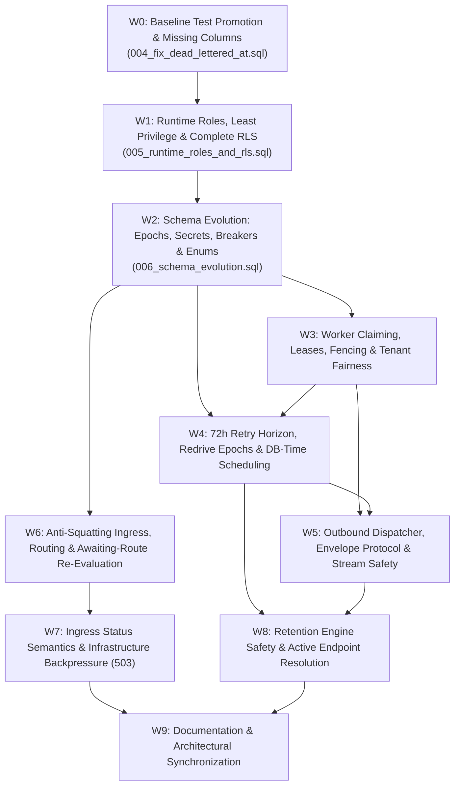

# CWIDS Definitive Remediation Plan & Engineering Architecture

**Document Version:** 1.0.0  
**Status:** PROPOSED (Stage 1 Architecture Complete — Awaiting Approval)  
**Target Environment:** Node.js (ESM `.mjs`, JSDoc + `tsc checkJs`), PostgreSQL 18+, Express, `pg`  
**Git Baseline Commit:** `68e0003`

---

## 1. Step 0 Audit Gap Verification Results

All tests below were executed against a real PostgreSQL 18.1 engine using the actual runtime roles (`cwids_ingress`, `cwids_worker`, `cwids_admin`) with least-privilege configurations (non-superusers, `BYPASSRLS = FALSE`).

| Item ID | Verdict | Evidence (File:Line, SQL, or Test Output) | Details & Architectural Assessment |
| :--- | :--- | :--- | :--- |
| **A5** (Intent Status Lifecycle & Grace Period) | **CONFIRMED-DEFECT** | `src/db/repositories/intents-repo.mjs:121`, `src/routing/routing-resolver.mjs:34-38`, `tests/audit/step0_verification.mjs:58-69` | `payment_intent_correlations.status` is set to `'active'` on insert and is **never** updated anywhere in the codebase (no `UPDATE` statements exist). An intent expired by 2 days (within the 7-day grace period) successfully routes via Mode A (`status: resolved`). However, if an intent is marked `'consumed'`, Mode A routing query filters `AND status = 'active'` and fails, returning `awaiting_route`. Consequently, subsequent events for consumed intents (refunds, chargebacks, dispute updates) are dropped into `awaiting_route`. |
| **E1** (Raw-Body Middleware Pipeline) | **NOT-PRESENT** | `src/ingress/http-server.mjs:20-25`, `tests/audit/step0_verification.mjs:75-90` | `rawBodyMiddleware` is registered before any `express.json()` parser. It captures the verbatim Buffer and calculates `payloadSha256` directly from socket bytes. Whitespace and key-order variations in JSON payloads do not alter verification bytes. |
| **E2** (Signature Verification Guard) | **NOT-PRESENT** | `src/ingress/webhook-handler.mjs:60-70`, `src/providers/paystack/adapter.mjs:42-55` | `adapter.verifyAndNormalize` executes prior to any routing resolution or database connection acquisition. Cryptographically invalid signatures return HTTP 401 and never reach database transactions. |
| **E3** (Atomic Persistence & Commit Boundary) | **NOT-PRESENT** | `src/ingestion/ingestion-service.mjs:47-150`, `src/ingress/webhook-handler.mjs:80-87` | Webhook event and initial delivery obligation are persisted within a single `withTransaction` block. In `webhook-handler.mjs`, HTTP 200 is issued strictly after `await IngestionService.ingestWebhook` successfully commits. |
| **E4** (Deduplication via Constraint) | **NOT-PRESENT** | `src/db/repositories/events-repo.mjs:24-38`, `tests/audit/step0_verification.mjs:93-115` | Deduplication relies entirely on PostgreSQL unique constraint `uq_webhook_events_dedupe` (`SQLSTATE 23505`) via `ON CONFLICT (...) DO NOTHING`. A duplicate insertion returns `rowCount: 0` and is cleanly absorbed without race conditions. |
| **E5** (Outbound SSRF Protection) | **NOT-PRESENT** | `src/security/ssrf-agent.mjs:28-110`, `tests/audit/step0_verification.mjs:118-124` | Custom `https.Agent` overrides `createConnection` with connection-time DNS resolution. Pinned to validated public IP via `net.connect` while `servername` passes original hostname for TLS SNI. RFC 1918, RFC 3927 (AWS metadata 169.254.169.254), loopback (127.0.0.1, `::1`), and link-local IPv6 ranges are blocked. Redirects are disabled. |
| **C1** (`legal_hold`, `audit_class`, `cwids_admin`) | **NOT-PRESENT** | `001_initial_schema.sql:88, 185-186`, `002_row_level_security.sql:55`, `tests/audit/step0_verification.mjs:129-148` | `legal_hold` exists on `webhook_events` and `administrative_audit_events`. `audit_class` exists on `administrative_audit_events`. Database role `cwids_admin` exists in `pg_roles`. |
| **C2** (HOT Updates Assumption) | **CONFIRMED-DEFECT** | `001_initial_schema.sql:150-155`, `003_partial_indexes.sql:8-14`, `tests/audit/step0_verification.mjs:150-158` | Specification debt claim (`DEBT-02`) states that delivery churn is mitigated by "HOT updates". In PostgreSQL, Heap-Only Tuple updates require that **no** indexed column is modified. On `event_deliveries`, `status`, `next_attempt_at`, and `lease_expires_at` are all indexed. Every delivery transition updates indexed columns, making HOT optimization impossible. |
| **C3** (Crashed Attempt Audit Logging) | **CONFIRMED-DEFECT** | `001_initial_schema.sql:159`, `src/db/repositories/deliveries-repo.mjs:214-222`, `tests/audit/step0_verification.mjs:160-165` | `delivery_attempts.finished_at` is `NOT NULL`. When a delivery worker crashes, zero attempt rows are written. Lease recovery sweeps reset `in_flight` to `retry_scheduled` without recording any crash attempt record. If recovery sweeps were to log a crashed attempt, `finished_at` cannot be null and must be given a synthetic crash timestamp. |
| **NEW-01** (Lease Duration vs Max HTTP Timeout) | **CONFIRMED-DEFECT** | `001_initial_schema.sql:31`, `src/config/limits.mjs:26`, `src/delivery/scheduler.mjs:29` | Constraint `ck_endpoint_timeout` permits `http_timeout_ms` up to 30,000ms (30s). `DEFAULT_LEASE_DURATION_MS` is hardcoded to 30s. A legitimate destination taking 28-30s causes the lease to expire during dispatch. Another worker claims or sweeps the delivery, resulting in double dispatch and rejection of the original worker's write via `StaleFencingTokenError`. No lease heartbeat or extension exists. |

---

## 2. Master Workstream Dependency Graph



---

## 3. Detailed Workstream Specifications

### Workstream W0: Baseline Test Promotion & Schema Patch (Blocker Fix)
- **Goal:** Fix the immediate schema incompatibility causing repository queries to crash against live PostgreSQL, and promote all audit test scripts into permanent, failing integration tests.
- **Prerequisites:** None.
- **Database Migration:**
  - `004_fix_dead_lettered_at.sql`
  - Safe on populated tables: `ALTER TABLE cwids.event_deliveries ADD COLUMN IF NOT EXISTS dead_lettered_at TIMESTAMPTZ;`
- **Files Touched:**
  - `src/db/migrations/004_fix_dead_lettered_at.sql` [NEW]
  - `tests/integration/audit-promotions/*.test.mjs` [NEW]
- **Failing Tests Added:**
  - Promote `tests/audit/a1_rls_test.mjs` -> `tests/integration/rls-runtime-roles.test.mjs` (Fails on RLS blocking)
  - Promote `tests/audit/a7_fairness_test.mjs` -> `tests/integration/circuit-breaker-probe.test.mjs` (Fails on half-open claim)
  - Promote `tests/audit/a9_stale_worker_test.mjs` -> `tests/integration/fenced-stale-worker.test.mjs` (Fails on stale attempt commit)
  - Promote `tests/audit/b1_mode_c_test.mjs` -> `tests/integration/mode-c-distinct.test.mjs` (Fails on duplicate alias quarantine)
  - Promote `tests/audit/b7_response_cap_test.mjs` -> `tests/integration/stream-truncation.test.mjs` (Fails on stream promise hang)
- **Acceptance Criteria:**
  - Migration 004 applies cleanly.
  - Queries in `DeliveriesRepo.findById`, `insertDelivery`, and `deadLetterDelivery` succeed on live PostgreSQL without column errors.
  - All promoted integration tests fail with exact diagnostic errors against real roles.
- **Rollback Strategy:** `ALTER TABLE cwids.event_deliveries DROP COLUMN IF EXISTS dead_lettered_at;`

---

### Workstream W1: Runtime Roles, Least Privilege & Complete RLS
- **Goal:** Eliminate RLS blockers for ingress and delivery workers while enforcing strict tenant isolation across all tables.
- **Prerequisites:** W0.
- **Database Migration:**
  - `005_runtime_roles_and_rls.sql`
  - Safe on populated tables:
    1. Enable and force RLS on tables previously missing RLS:
       - `payment_intent_aliases`
       - `delivery_attempts`
       - `circuit_breaker_states`
       - `reconciliation_records`
       - `administrative_audit_events`
       - `audit_outbox`
    2. Add `application_id UUID REFERENCES cwids.applications(id)` to `payment_intent_aliases` and `delivery_attempts`. Backfill existing rows via joins from parent tables.
    3. Define specific role policies:
       - For `cwids_ingress`: Policy allowing `SELECT` on `applications`, `payment_intent_correlations`, `payment_intent_aliases`, and `provider_connections` without tenant context for Mode A/B/C routing resolution.
       - For `cwids_worker`: Policy allowing `SELECT`, `UPDATE` on `event_deliveries`, `delivery_attempts`, and `circuit_breaker_states` across all tenants for batch claim processing.
       - For `cwids_admin`: Policy allowing operations scoped to administrative contexts.
       - For Tenant Contexts: Enforce `(application_id = NULLIF(current_setting('app.current_tenant', true), '')::uuid)`.
    4. Confirm no runtime role has `BYPASSRLS` and all tables are owned by `cwids_migrator` or `postgres`.
- **Files Touched:**
  - `src/db/migrations/005_runtime_roles_and_rls.sql` [NEW]
  - `src/db/repositories/intents-repo.mjs`
  - `src/db/repositories/attempts-repo.mjs`
  - `src/db/transaction.mjs`
- **Failing Tests to Pass:**
  - `tests/integration/rls-runtime-roles.test.mjs`
- **Acceptance Criteria:**
  - `cwids_ingress` with no tenant context can query `applications` by API key hash and resolve Mode A/C payment intents.
  - `cwids_worker` with no tenant context claims deliveries across multiple tenants.
  - Tenant A cannot query Tenant B's rows in `payment_intent_aliases`, `delivery_attempts`, or `administrative_audit_events`.
- **Rollback Strategy:** Revert policies in migration rollback block.

---

### Workstream W2: Schema Evolution: Epochs, Secrets, Breakers & Enums
- **Goal:** Add redrive epoch tracking, envelope encryption for destination secrets, automatic circuit breaker row provisioning, and correct status enums.
- **Prerequisites:** W1.
- **Database Migration:**
  - `006_schema_evolution.sql`
  - Safe on populated tables:
    1. `event_deliveries`:
       - Add `epoch_id UUID NOT NULL DEFAULT gen_random_uuid()`
       - Add `epoch_attempt_count INTEGER NOT NULL DEFAULT 0`
       - Add `redrive_count INTEGER NOT NULL DEFAULT 0`
       - Add `horizon_started_at TIMESTAMPTZ NOT NULL DEFAULT CURRENT_TIMESTAMP`
       - Add index on `(application_id, status, next_attempt_at)`
    2. `destination_endpoints`:
       - Add `encrypted_signing_secret BYTEA`
       - Add `secret_nonce BYTEA`
       - Add `secret_tag BYTEA`
       - Add `secret_kek_version TEXT DEFAULT 'v1'`
       - Backfill ciphertext from existing `signing_secret` using Master KEK envelope, then drop or deprecate plaintext column.
    3. `applications`:
       - Update check constraint: `ALTER TABLE cwids.applications DROP CONSTRAINT ck_application_status;`
       - `ALTER TABLE cwids.applications ADD CONSTRAINT ck_application_status CHECK (status IN ('pending', 'active', 'suspended', 'disabled', 'retired'));`
    4. Trigger / Initialization for Circuit Breaker:
       - Add trigger on `destination_endpoints` insert to automatically create a default `closed` row in `circuit_breaker_states` with `half_open_probe_in_flight = false`.
- **Files Touched:**
  - `src/db/migrations/006_schema_evolution.sql` [NEW]
  - `src/types/delivery.mjs`
  - `src/types/domain.mjs`
  - `src/admin/internal-api.mjs`
- **Acceptance Criteria:**
  - Epoch fields exist on `event_deliveries`.
  - Destination secrets are encrypted at rest with Master KEK.
  - Applications can be created with status `'pending'`.
  - Creating a destination endpoint automatically guarantees a corresponding row in `circuit_breaker_states`.
- **Rollback Strategy:** Drop newly added columns and restore previous constraint definitions.

---

### Workstream W3: Worker Claiming, Leases, Fencing & Tenant Fairness
- **Goal:** Implement atomic half-open probe claiming, dynamic lease sizing with timeout padding, in-SQL tenant fair-share claim partitioning, and strict fenced write rollback.
- **Prerequisites:** W2.
- **Architecture & Implementation Details:**
  1. **In-SQL Fairness & Claim Partitioning:**
     Replace the global `ORDER BY next_attempt_at ASC LIMIT $1` in `DeliveriesRepo.claimBatch` with a partitioned query:
     ```sql
     WITH ranked_claimable AS (
       SELECT ed.id,
              ROW_NUMBER() OVER (
                PARTITION BY ed.application_id 
                ORDER BY ed.next_attempt_at ASC
              ) as tenant_rank
       FROM cwids.event_deliveries ed
       LEFT JOIN cwids.circuit_breaker_states cb ON ed.destination_endpoint_id = cb.destination_endpoint_id
       WHERE ed.status IN ('pending', 'retry_scheduled')
         AND ed.next_attempt_at <= CURRENT_TIMESTAMP
         AND (
           cb.state IS NULL 
           OR cb.state = 'closed'
           OR (cb.state = 'half_open' AND cb.half_open_probe_in_flight = FALSE)
         )
     ),
     selected_batch AS (
       SELECT id FROM ranked_claimable
       WHERE tenant_rank <= $1 -- Per-tenant burst cap per cycle
       ORDER BY tenant_rank ASC
       LIMIT $2 -- Global worker batch limit
       FOR UPDATE OF ed SKIP LOCKED
     )
     ...
     ```
  2. **Atomic Half-Open Probe Locking:**
     When claiming an endpoint in `half_open` state, atomically set `half_open_probe_in_flight = TRUE` in the claim transaction. Exactly 1 probe is claimed.
  3. **Open-to-Half-Open Background Sweeper:**
     Create `CircuitBreakerSweeper` running every 10 seconds:
     ```sql
     UPDATE cwids.circuit_breaker_states
     SET state = 'half_open',
         half_open_probe_in_flight = FALSE,
         updated_at = CURRENT_TIMESTAMP
     WHERE state = 'open'
       AND opened_at + make_interval(secs => $1) <= CURRENT_TIMESTAMP;
     ```
  4. **Dynamic Lease Sizing & Extension:**
     Lease duration for each claim is sized as:
     `lease_seconds = ceil(endpoint.http_timeout_ms / 1000) + 30`.
     Endpoints with 30s timeouts receive 60s leases, eliminating lease expiration during legitimate slow HTTP requests.
  5. **Strict Fenced Write Rollback (A9 Fix):**
     In `src/delivery/delivery-service.mjs`:
     - Execute the fenced delivery update FIRST: `DeliveriesRepo.completeDelivery(...)` or `scheduleRetry(...)`.
     - Inspect `rowCount`. If `rowCount !== 1`:
       **THROW `StaleFencingTokenError` IMMEDIATELY**.
     - Only after the fenced update succeeds, insert `AttemptsRepo.recordAttempt`.
     - On error, `withTransaction` rolls back both attempt and delivery updates, preventing stale attempts from polluting `delivery_attempts`.
  6. **Bounded Poison-Pill Lease Recovery (B8 Fix):**
     In `DeliveriesRepo.recoverExpiredLeases`:
     Increment `epoch_attempt_count = epoch_attempt_count + 1`, set `status = 'retry_scheduled'`, and compute backoff `next_attempt_at = CURRENT_TIMESTAMP + interval '30 seconds'`. If `epoch_attempt_count >= max_retries`, transition directly to `dead_lettered` with reason `EXPIRED_LEASE_POISON_PILL`.
- **Files Touched:**
  - `src/db/repositories/deliveries-repo.mjs`
  - `src/delivery/circuit-breaker.mjs`
  - `src/delivery/delivery-service.mjs`
  - `src/delivery/lease-manager.mjs`
  - `src/delivery/scheduler.mjs`
- **Failing Tests to Pass:**
  - `tests/integration/circuit-breaker-probe.test.mjs`
  - `tests/integration/fenced-stale-worker.test.mjs`
- **Acceptance Criteria:**
  - Half-open endpoint allows exactly 1 canary dispatch.
  - Open circuit automatically transitions to half-open after 120s cooldown via background sweeper.
  - Tenant A with 10k rows does not starve Tenant B (claims are partitioned).
  - Stale worker write leaves 0 attempt rows and rolls back cleanly.
  - Expired lease increments attempt count and applies backoff.

---

### Workstream W4: 72h Retry Horizon, Redrive Epochs & DB-Time Scheduling
- **Goal:** Enforce true 72-hour delivery horizon from first failed attempt, safe redrive epoch semantics, and database-time scheduling.
- **Prerequisites:** W2, W3.
- **Architecture & Implementation Details:**
  1. **Redrive Epoch Architecture (A3 Fix):**
     In `DeliveriesRepo.redriveDelivery`:
     ```sql
     UPDATE cwids.event_deliveries
     SET status = 'pending',
         epoch_id = gen_random_uuid(),
         epoch_attempt_count = 0,
         redrive_count = redrive_count + 1,
         horizon_started_at = CURRENT_TIMESTAMP,
         next_attempt_at = CURRENT_TIMESTAMP,
         fencing_token = fencing_token + 1,
         lease_expires_at = NULL,
         terminal_reason = NULL,
         updated_at = CURRENT_TIMESTAMP
     WHERE id = $1 AND status = 'dead_lettered'
     RETURNING ...
     ```
     `attempt_count` (monotonic counter) is **preserved** so `attemptNumber = claim.attempt_count + 1` never collides with past attempts in `delivery_attempts(delivery_id, attempt_number)`.
  2. **72h Horizon Calculation:**
     - Horizon is measured against `horizon_started_at` (persisted on delivery creation and reset on redrive).
     - Calculate retry delays using PostgreSQL `CURRENT_TIMESTAMP + ($jittered_ms || ' milliseconds')::interval`.
     - Cap `next_attempt_at = LEAST(CURRENT_TIMESTAMP + delay, horizon_started_at + INTERVAL '72 hours')`.
     - When `CURRENT_TIMESTAMP + delay >= horizon_started_at + INTERVAL '72 hours'`: schedule a final attempt clamped exactly at the horizon cutoff before dead-lettering.
  3. **Jitter Strategy:**
     Use symmetric bounded jitter: `[0.5 * capped_delay, 1.5 * capped_delay]` with a minimum floor of 5,000ms to eliminate near-zero retry storms.
- **Files Touched:**
  - `src/delivery/retry-policy.mjs`
  - `src/db/repositories/deliveries-repo.mjs`
  - `src/delivery/delivery-service.mjs`
- **Acceptance Criteria:**
  - Dead-lettered delivery past 72h, when redriven, receives a fresh 72h window and does not dead-letter on first failure.
  - Attempt numbers continue monotonically (`16, 17, ...`) without unique key collisions.
  - Delays are evaluated relative to `CURRENT_TIMESTAMP` in database time.

---

### Workstream W5: Outbound Dispatcher, Envelope Protocol & Stream Safety
- **Goal:** Eliminate promise hang on streaming responses, implement v2 s23.7 envelope verification, and correct HTTP status classifications.
- **Prerequisites:** W3.
- **Architecture & Implementation Details:**
  1. **Stream Severing Safety (B7 Fix):**
     In `src/delivery/http-dispatcher.mjs`:
     When `totalBytes > LIMITS.MAX_RESPONSE_EXCERPT_BYTES`:
     - Capture up to 2,048 bytes.
     - Call `res.destroy()`.
     - Immediately invoke `finish({ httpStatus, responseStatus, responseExcerpt, isTruncated: true, ... })`.
     - Add `res.on('close', ...)` listener to ensure socket closure cleanly settles the Promise even if `'end'` never fires.
     - Verify heap memory remains completely flat when receiving a 50MB continuous stream.
  2. **Response Envelope Protocol & Classification (B2 Fix):**
     Inspect response body according to configured endpoint mode:
     - **Envelope Mode (Standard v2 s23.7):**
       Examine JSON response:
       - `{ "status": "processed", "delivery_id": "<id>" }` -> Success (`delivered`).
       - `{ "status": "duplicate_acknowledged", "delivery_id": "<id>" }` -> Success (`delivered`).
       - `{ "status": "rejected", "delivery_id": "<id>" }` -> Non-retryable failure (`dead_lettered`, `CLIENT_REJECTED`).
       - Missing envelope or mismatching `delivery_id` -> Protocol failure (`retry_scheduled`).
     - **Compatibility Mode (Raw HTTP Status):**
       - 200, 201, 202 -> `delivered` (`processed`).
       - 204 -> `delivered` (`http_acknowledged_unverified`).
       - 408, 425, 429 -> Transient failure (`retry_scheduled`).
       - 500, 502, 503, 504 -> Transient failure (`retry_scheduled`).
       - 501 (`Not Implemented`) -> Permanent failure (`dead_lettered`, `UNRETRYABLE_ERROR`).
       - 400, 401, 403, 404, 405, 410, 422 -> Permanent failure (`dead_lettered`, `CLIENT_REJECTED`) [Subject to Decision 1].
- **Files Touched:**
  - `src/delivery/http-dispatcher.mjs`
  - `src/delivery/retry-policy.mjs`
  - `src/delivery/delivery-service.mjs`
- **Failing Tests to Pass:**
  - `tests/integration/stream-truncation.test.mjs`
- **Acceptance Criteria:**
  - 50MB stream terminates in <100ms, memory stays flat, and promise resolves with `isTruncated: true`.
  - Processed 200 response with >2KB body is marked `delivered`.
  - HTTP 501 is classified as non-retryable.
  - JSON envelope with `duplicate_acknowledged` is marked `delivered`.

---

### Workstream W6: Anti-Squatting Ingress, Routing & Awaiting-Route Re-Evaluation
- **Goal:** Prevent cross-tenant reference/alias squatting, fix Mode C multiple match duplicates, support subsequent events on consumed intents, and re-evaluate awaiting_route events on alias registration.
- **Prerequisites:** W1, W2.
- **Architecture & Implementation Details:**
  1. **Mode C Duplicate Query Fix (B1 Fix):**
     In `src/routing/routing-resolver.mjs`:
     ```sql
     SELECT DISTINCT pic.id, pic.application_id
     FROM cwids.payment_intent_aliases pia
     JOIN cwids.payment_intent_correlations pic ON pia.payment_intent_id = pic.id
     WHERE pia.provider_connection_id = $1
       AND pia.environment = $2
       AND ((pia.alias_type = 'provider_reference' AND pia.alias_value = $3)
         OR (pia.alias_type = 'virtual_account_id' AND pia.alias_value = $4))
       AND pic.status IN ('active', 'consumed')
     ```
     Add `DISTINCT` to ensure multiple alias matches on the same intent return 1 row.
  2. **Multi-Event Intent Support (A5 Fix):**
     Update routing queries (Mode A and Mode C) to match `pic.status IN ('active', 'consumed')`. When a refund or chargeback arrives for an already-consumed intent, it routes to the correct application instead of becoming stranded.
  3. **Anti-Squatting Reference Guard (A6 Fix):**
     On shared provider connections (`provider_connections.application_id IS NULL`):
     - Enforce application code prefix: `merchant_reference` must begin with `${app.code}_`.
     - Reject dynamic aliases asserted by tenants on shared connections unless accompanied by a verified provider signature or restricted to dedicated connections.
  4. **Awaiting-Route Re-Evaluation Engine (B5 Fix):**
     When `POST /v1/internal/payment-intents/:id/aliases` registers an alias:
     In the same transaction:
     ```sql
     SELECT id, payload_sha256 FROM cwids.webhook_events
     WHERE routing_status = 'awaiting_route'
       AND provider_connection_id = $1
       AND resource_reference = $alias_value
     FOR UPDATE SKIP LOCKED;
     ```
     For matching events:
     - Update `webhook_events SET routing_status = 'resolved', application_id = $app_id, payment_intent_id = $intent_id`.
     - Insert delivery obligation into `event_deliveries`.
     - Record audit event `alias.awaiting_route_resolved`.
- **Files Touched:**
  - `src/routing/routing-resolver.mjs`
  - `src/admin/internal-api.mjs`
  - `src/db/repositories/intents-repo.mjs`
  - `src/db/repositories/events-repo.mjs`
- **Failing Tests to Pass:**
  - `tests/integration/mode-c-distinct.test.mjs`
- **Acceptance Criteria:**
  - Both `providerReference` and `virtualAccountId` matching the same intent resolves cleanly via Mode C without quarantine.
  - Subsequent webhooks for consumed intents route to the owning application.
  - Cross-tenant squatting on shared connections is blocked.
  - Registering an alias routes existing `awaiting_route` events and creates delivery obligations.

---

### Workstream W7: Ingress Status Semantics & Infrastructure Backpressure (503)
- **Goal:** Correct ingress error semantics (HTTP 503 on DB saturation, HTTP 400 for malformed JSON, and encrypted rejection logging).
- **Prerequisites:** W6.
- **Architecture & Implementation Details:**
  1. **Infrastructure Backpressure (503 with Retry-After):**
     In `src/ingress/webhook-handler.mjs`:
     When pool connection acquisition times out (`timeout exceeded when acquiring client`):
     - Return HTTP 503 (`Service Unavailable`)
     - Set header `Retry-After: 30`
     - Do not log as unhandled 500 error.
  2. **Malformed JSON vs Invalid Signature Semantics (B3 Fix):**
     In `src/ingress/webhook-handler.mjs`:
     - If signature verification fails -> HTTP 401 Unauthorized.
     - If signature is valid, but payload is malformed JSON or unsupported event type:
       [Subject to Decision 2] Persist encrypted payload to `webhook_events` with `routing_status = 'rejected'` and return HTTP 200 `{ status: 'acknowledged', routing_status: 'rejected' }`.
       If Decision 2 chooses rejection: return HTTP 400 Bad Request, never 401.
- **Files Touched:**
  - `src/ingress/webhook-handler.mjs`
  - `src/providers/paystack/adapter.mjs`
  - `src/providers/flutterwave/adapter.mjs`
- **Acceptance Criteria:**
  - Pool saturation returns HTTP 503 with `Retry-After: 30`.
  - Malformed JSON with valid signature never returns 401.
  - Rejected events persist encrypted records when configured.

---

### Workstream W8: Retention Engine Safety & Active Endpoint Resolution
- **Goal:** Prevent silent deletion of unrouted/quarantined events, and ensure retrying deliveries resolve active endpoint configurations.
- **Prerequisites:** W4, W5.
- **Architecture & Implementation Details:**
  1. **Retention Engine Safety Guard (B4 Fix):**
     In `src/db/repositories/events-repo.mjs` (`purgeExpiredMetadata`):
     Update purge candidate query to explicitly exclude unrouted events:
     ```sql
     WHERE we.received_at < $1
       AND we.legal_hold = FALSE
       AND we.routing_status = 'resolved' -- Exclude awaiting_route and quarantined!
       AND NOT EXISTS (
         SELECT 1 FROM cwids.event_deliveries ed
         WHERE ed.event_id = we.id AND ed.status NOT IN ('delivered', 'cancelled')
       )
     ```
     For unrouted / quarantined events older than 90 days:
     Do NOT silently delete. Emit high-priority administrative audit records and Prometheus counter `cwids_unrouted_events_retention_alert`.
  2. **Active Endpoint Resolution at Dispatch (B6 Fix):**
     In `src/delivery/delivery-service.mjs`:
     When claiming a delivery:
     - Query destination endpoint:
       ```sql
       SELECT id, version, url, encrypted_signing_secret, secret_nonce, secret_tag,
              http_timeout_ms, max_retries
       FROM cwids.destination_endpoints
       WHERE application_id = $1 AND status = 'active'
       ORDER BY version DESC LIMIT 1
       ```
     - If active version is newer than snapshotted ID, dispatch to the new active URL using the rotated secret.
     - Record both `destination_endpoint_id` and `endpoint_version` in `delivery_attempts` on every attempt for forensic auditability.
- **Files Touched:**
  - `src/db/repositories/events-repo.mjs`
  - `src/maintenance/retention-worker.mjs`
  - `src/delivery/delivery-service.mjs`
- **Acceptance Criteria:**
  - `awaiting_route` and `quarantined` events are never silently deleted by retention sweeps.
  - Updating an endpoint URL or secret immediately applies to subsequent retries of pending deliveries.
  - Every delivery attempt records the exact endpoint version dispatched.

---

### Workstream W9: Documentation & Architectural Synchronization
- **Goal:** Synchronize technical specifications, architecture updates, and README documentation with the true implemented reality.
- **Prerequisites:** W0 through W8.
- **Documentation Updates:**
  1. `docs/CWIDS-TECHNICAL-SPECIFICATION.md`:
     - Update retry mathematics: replace 15-attempt formula with 72h horizon epoch model.
     - Remove obsolete HOT update claims (`DEBT-02`).
     - Document `dead_lettered_at`, `epoch_id`, `epoch_attempt_count`, and `redrive_count`.
     - Align `applications.status` with `('pending', 'active', 'suspended', 'disabled', 'retired')`.
     - Document dynamic lease sizing (`timeout + 30s`) in place of 30s static leases.
  2. `README.md` & `docs/cwids-architecture-update-v2.md`:
     - Align ingress error codes (HTTP 503 pool timeout).
     - Document anti-squatting requirements on shared provider connections.
- **Files Touched:**
  - `docs/CWIDS-TECHNICAL-SPECIFICATION.md`
  - `docs/cwids-architecture-update-v2.md`
  - `README.md`
- **Acceptance Criteria:**
  - 100% concordance between schema DDL, codebase implementation, and documentation. Zero contradictory claims.

---

## 4. Key Architectural Decisions (Project Owner Review Required)

### Decision 1: Handling Destination 4xx Status Codes (401, 403, 404, 405) & 408, 425
- **Context:** Currently, CWIDS treats all 4xx codes (except 408 and 429) as non-retryable client rejections and dead-letters immediately.
- **Recommendation:** **Retry within the 72h horizon with operational alerts.** Classify 408 (`Request Timeout`) and 425 (`Too Early`) as transient retryable. For 401, 403, 404, and 405, allow retries with backoff up to the 72h horizon, but trigger a Prometheus alert after 3 consecutive failures.
- **Trade-off:** Destination applications frequently experience deployment misconfigurations (e.g. temporary routing errors, expired service tokens, WAF false-positives). Immediate dead-lettering requires manual operator intervention for hundreds of customer payments; retrying allows transient destination deployment errors to self-heal within the 72h window, with negligible traffic overhead under exponential backoff.

### Decision 2: Authenticated but Malformed or Unsupported Events
- **Context:** When an incoming webhook has a valid cryptographic signature from Paystack or Flutterwave, but contains malformed JSON or an unknown/unsupported event type.
- **Recommendation:** **Persist encrypted payload with `routing_status = 'rejected'` and return HTTP 200.**
- **Trade-off:** Persisting authentic payloads guarantees an immutable audit trail of every cryptographically verified byte transmitted by the payment provider. If a provider rolls out an unannounced webhook schema change, CWIDS has preserved the evidence and can replay it once an adapter patch is deployed. Rejecting with HTTP 400 drops the payload from disk and prevents downstream recovery.

### Decision 3: Multi-Tenant Anti-Squatting Architecture
- **Context:** Multiple tenants sharing a single provider connection could potentially register matching `merchant_reference` strings or aliases.
- **Recommendation:** **Enforce server-controlled prefix namespacing on shared connections (`${app.code}_${reference}`).** Only accept dynamic aliases on shared connections if cryptographically validated against the provider or if deployed on dedicated (Mode B) connections.
- **Trade-off:** Requires tenant payment clients on shared accounts to prefix their checkout references, but prevents any tenant from hijacking another tenant's payment webhooks without requiring separate provider merchant accounts.

### Decision 4: Redrive Epoch Architecture & Authorization
- **Context:** Redriving dead-lettered deliveries past 72h requires a fresh retry window without corrupting monotonic attempt numbering in `delivery_attempts`.
- **Recommendation:** **Implement separate epoch fields (`epoch_id`, `epoch_attempt_count`, `redrive_count`, `horizon_started_at`) on `event_deliveries`.** Restrict redrives strictly to authenticated administrators with the `cwids_admin` role.
- **Trade-off:** Maintains monotonic `attempt_count` for tamper-proof network audit trails while granting an explicit, controlled 72-hour delivery epoch on operator demand.

### Decision 5: Retry Attempt Ceiling & Jitter Bounds
- **Context:** The previous attempt ceiling (15 attempts) exhausted in ~16 hours on average, failing to reach the 72-hour window.
- **Recommendation:** **Horizon-first termination policy.** The 72-hour window governs retry termination; an attempt ceiling of 50 acts purely as an emergency runaway ceiling. Jitter is bounded to `[0.5 * delay, 1.5 * delay]` with a 5-second floor.
- **Trade-off:** Ensures genuine 72-hour payment delivery persistence during major destination outages without creating dense retry storms.

### Decision 6: Dynamic Endpoint Version Resolution at Dispatch
- **Context:** Pending deliveries currently snapshot a `destination_endpoint_id` at ingest. When secrets are rotated or URLs updated, retrying deliveries hit dead endpoints.
- **Recommendation:** **Resolve the latest `active` endpoint version dynamically at dispatch time.** Record both the endpoint ID and version in `delivery_attempts` on every dispatch.
- **Trade-off:** Pending webhooks automatically recover when a destination endpoint URL or secret is corrected, eliminating manual delivery-by-delivery rebinding.

### Decision 7: Application Status Enum Alignment
- **Context:** Code DDL contains `CHECK (status IN ('active', 'suspended', 'disabled', 'retired'))`, while documentation specifies `('pending', 'active', 'suspended', 'retired')`.
- **Recommendation:** **Expand schema constraint to include `'pending'`.**
- **Trade-off:** Aligns code and documentation, allowing newly onboarded applications to be registered in `'pending'` until endpoint verification tests succeed.

---

## 5. Items Requiring Provider Documentation or Real Traffic Fixtures

The following items are based on assumptions in architectural discussions that are not yet backed by official provider documentation or captured traffic fixtures in the repository:

1. **Provider 503 Retry Behavior:** Documentation assumes Flutterwave and Paystack recognize HTTP 503 with `Retry-After: 30` as temporary backpressure and retry without disabling webhooks. *Need: Official Flutterwave and Paystack webhook documentation confirming HTTP 503 and `Retry-After` parsing.*
2. **Provider Replay Payload Consistency:** Documentation assumes duplicate webhook redeliveries contain identical byte-for-byte payloads. Real-world providers occasionally alter timestamp wrappers, internal metadata, or JSON formatting on retries. *Need: Signed real-world provider test fixtures for duplicate events, status changes, and refund notifications.*
3. **Provider Re-query Rate Limits:** Reconciliation workers assume verification endpoints tolerate 5 req/sec sustained querying. *Need: Documented rate limits for Paystack `GET /transaction/verify/:id` and Flutterwave `GET /v3/transactions/:id/verify`.*

---

## 6. Critical Engineering Counter-Arguments & Nuances

We disagree with or provide nuanced engineering alternatives to the following points in the review brief:

1. **Adding an immutable `ck_delivery_horizon` DDL check constraint:**
   - *Brief Suggestion:* Add `ck_delivery_horizon` verifying `next_attempt_at <= first_attempt_at + INTERVAL '72 hours'`.
   - *Engineers' Analysis:* In PostgreSQL, table CHECK constraints must be deterministic and immutable. Comparing timestamps against dynamic intervals across table mutations creates rigidity. More critically, if different tenant applications require configurable retry horizons (e.g. 24h for rapid retail, 72h for high-value banking, 7 days for inter-bank clearing), a table-level check constraint prohibits multi-tier SLAs. We recommend enforcing the horizon in SQL query updates (`next_attempt_at = LEAST(...)`) and worker domain logic rather than an inflexible DDL constraint.
2. **Timer-Based Lease Heartbeats vs Dynamic Lease Sizing:**
   - *Brief Suggestion:* Implement active lease renewal/heartbeat threads during outbound HTTP dispatch.
   - *Engineers' Analysis:* Timer-based heartbeats running every 5–10s across hundreds of concurrent Node.js asynchronous outbound dispatches introduce timer churn and massive database write amplification (`UPDATE event_deliveries SET lease_expires_at = ... WHERE fencing_token = ...`). Instead, **Dynamic Lease Sizing** (`lease_seconds = http_timeout_ms / 1000 + 30`) mathematically guarantees that a legitimate slow request cannot outlive its lease, achieving complete safety with zero database heartbeat overhead.
3. **Handling of HTTP 204 No Content:**
   - *Brief Suggestion:* In envelope mode, 204 is a protocol failure.
   - *Engineers' Analysis:* We agree that when envelope mode is strictly negotiated, 204 lacks the required JSON payload envelope (`{ "status": "processed", "delivery_id": "..." }`). However, to avoid rejecting legacy destination applications that rely on standard HTTP 204 No Content acknowledgements, CWIDS destination endpoints should explicitly configure `response_validation_mode: 'envelope' | 'http_status'`, defaulting to `http_status` for broad compatibility.

---
*(End of Remediation Plan. Awaiting explicit user approval before proceeding to Stage 2 implementation.)*
